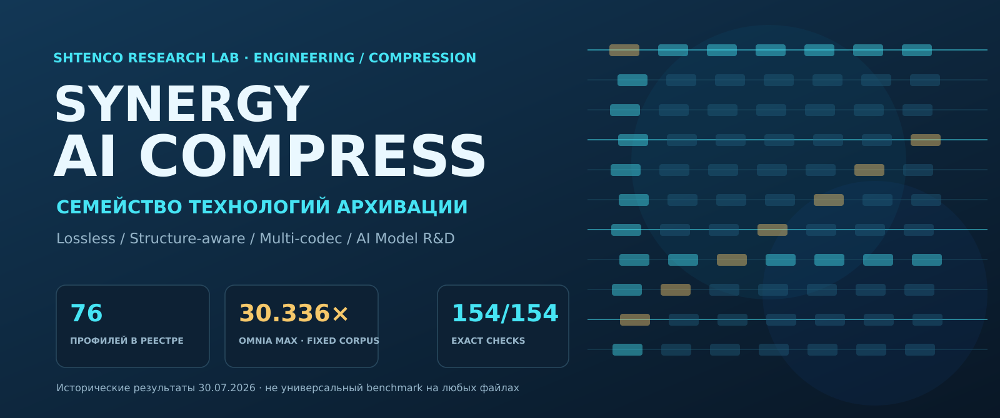
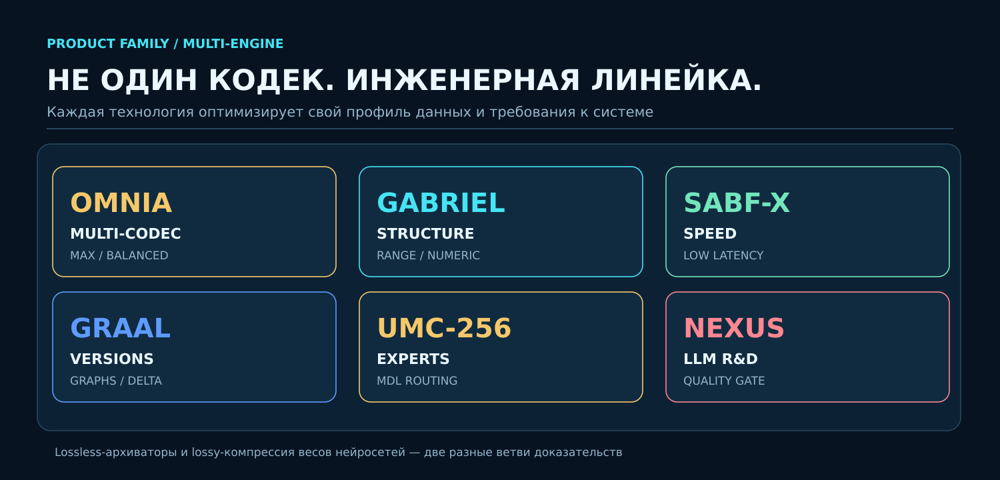
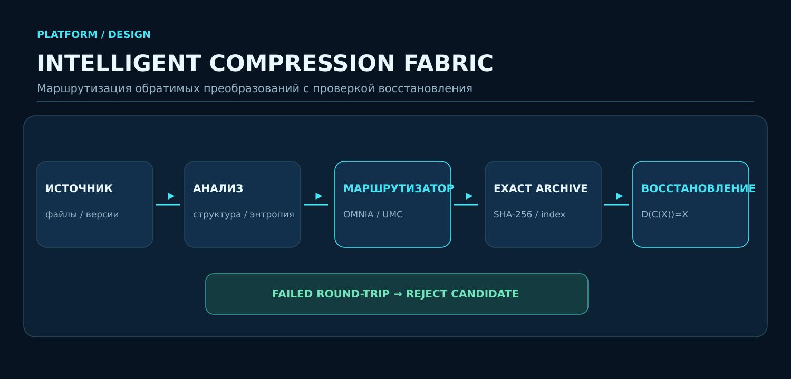

 <p align="center"></p>

<h1 align="center">SHTENCO SYNERGY AI COMPRESS</h1>

<p align="center"><strong>Собственная архитектура lossless-компрессии для структурированных данных, архивов, версий и вычислительных артефактов.</strong></p>

<p align="center">Compression Research · Archival Systems · Entropy Coding · Reversible Data Modeling · Enterprise Storage</p>

<p align="center"></p>

---

## Инвестиционный тезис

**SHTENCO SYNERGY AI COMPRESS — не один кодек и не оболочка над сторонними архиваторами. Это исследовательская и инженерная платформа, объединяющая собственные архивные форматы, обратимые преобразования, специализированные модели данных, энтропийное кодирование и стратегии выбора компрессионного конвейера.**

Проект исследует, как использовать структуру данных до этапа энтропийного кодирования: выявлять повторяемость, зависимости между блоками и версиями, закономерности представления, пространственную организацию и структуру бинарных объектов. Цель — уменьшать избыточность на уровне представления, а затем кодировать полученный поток с учётом ограничений по размеру архива, скорости, памяти и стоимости восстановления.

Вместо предположения, что один универсальный алгоритм одинаково хорошо работает на всех данных, SHTENCO развивает семейство профилей и методов для разных режимов хранения и вычисления.

> **Ключевой статус корректности: 81/81.** В актуальном внутреннем контрольном наборе все 81 проверяемые конфигурации прошли предусмотренную проверку точного восстановления. Это результат проверки целостности в рамках данного набора, а не заявление о победе над каждым мировым архиватором на любом типе данных. Методика, состав корпуса и среда тестирования должны сопровождать любые сравнительные выводы.

## Что создаётся

<p align="center"></p>

### 1. Самостоятельные архиваторы и контейнеры

SHTENCO включает отдельные архивные конвейеры и контейнерные архитектуры, предназначенные для сохранения исходных данных, контроля целостности и применения специализированных режимов декодирования. Контейнер может хранить служебные параметры, режим преобразования, размеры и контрольные значения, необходимые для корректного восстановления.

### 2. Обратимые модели и преобразования

До энтропийного этапа данные могут преобразовываться в более удобное для кодирования представление. В исследуемых семействах используются дельта-представления, XOR-зависимости, byte-plane transforms, графовые связи, обработка блоков и версий, пространственные представления, разбиение на сегменты и другие обратимые схемы.

Преобразование считается пригодным для lossless-конвейера только при условии, что исходный поток можно восстановить без потерь. Эффективность конкретного метода зависит от структуры входа; преобразование не обязано улучшать каждый файл, поэтому важны измерение полной стоимости и безопасный fallback.

### 3. Энтропийное кодирование

Энтропийный уровень — самостоятельное направление разработки. В технологическом портфеле исследуются арифметическое кодирование, rANS, Huffman и специализированные варианты представления остаточных потоков. В отдельных профилях могут применяться также внешние entropy backend, включая Zstandard. Эти варианты следует различать в технических описаниях и benchmark-отчётах: использование стороннего backend в конкретном конвейере не означает, что вся платформа сводится к нему.

### 4. Маршрутизация и оптимизация под задачу

Разные профили ориентированы на различные компромиссы:

- **Speed-first** — ограничение задержки и вычислительных затрат;
- **Balanced** — компромисс между размером архива и временем;
- **Size-first** — более интенсивный поиск компактного представления;
- **Structure-aware** — использование известных свойств входных данных;
- **Version-aware** — эксплуатация сходства между версиями и блоками;
- **Random-access / progressive** — архитектуры, в которых важны выборочное чтение или поэтапное восстановление, если это поддерживается конкретным форматом.

Название профиля само по себе не является доказательством производительности. Выбор должен подтверждаться воспроизводимыми измерениями на соответствующей нагрузке.

## Технологический портфель

<p align="center"></p>

### SABF-X

Семейство профилей, ориентированных на эффективный компрессионный конвейер с акцентом на скорость либо баланс размера и времени. Используется как один из основных ориентиров при сравнении практической эффективности.

### PBM-39X

Специализированный архивный маршрут для определённых структурированных представлений, включая отдельный путь для совместимого с BIP39 словарного текста при выполнении условий распознавания. Специализированная ветка применима только к соответствующему входу и не предполагает универсального преимущества на произвольных байтах.

### OMNIA

Семейство профилей, исследующих маршрутизацию и выбор между вариантами обработки с различными затратами на кодирование и декодирование. Режимы Speed, Balanced и MAX предназначены для разных ограничений; наиболее вычислительно дорогой режим не следует автоматически считать лучшим эксплуатационным выбором.

### Gabriel Horn

Отдельное направление архивной архитектуры, в котором исследуются обратимые преобразования, блоковая организация, оболочечные представления и индексируемая структура контейнера. Возможности выборочного доступа и progressive decoding относятся к конкретной реализации и должны проверяться соответствующими тестами.

### GRAAL / EGD / TSC-X / NEXUS-UMC

Семейства, охватывающие графовое моделирование, работу с похожими блоками и версиями, пространственные и byte-plane преобразования, а также специализированную маршрутизацию. Их потенциальная ценность заключается в использовании структуры данных до энтропийного кодирования, а не только в смене уровня компрессии.

### Энтропийные кодировщики

Arithmetic coding, adaptive arithmetic coding, range coding, rANS и Huffman представлены как отдельные направления и контрольные реализации в исследовательском портфеле. Для корректного сравнения должны учитываться не только размер битового потока, но и стоимость передачи модели, таблиц, заголовков и метаданных, а также время кодирования и декодирования.

## Принципы инженерной достоверности

SHTENCO ориентирован на проверяемую lossless-компрессию, где результат должен подтверждаться восстановлением, а не только заявленным коэффициентом сжатия.

- **Точное восстановление.** Сравнение восстановленного содержимого с исходными данными.
- **Контроль целостности.** Размер и криптографический digest могут использоваться для обнаружения повреждения или некорректного декодирования.
- **Полная стоимость архива.** Учитываются контейнер, заголовки, модели, словари, индексы и иные служебные данные.
- **Измерение двух направлений.** Важны как кодирование, так и декодирование.
- **Профильная оценка.** Размер, throughput, latency, RAM и доступ к данным рассматриваются как отдельные измерения.
- **Безопасный fallback.** Если специализированное представление не даёт выигрыша, система должна иметь возможность сохранить исходные данные или выбрать другой допустимый маршрут.
- **Разделение фактов и гипотез.** Внутренний тест, независимый benchmark и промышленный пилот — разные уровни доказательности.

## Проверка корректности: 81/81

**Внутренний контрольный результат: 81 из 81 проверяемых конфигураций прошли проверку точного восстановления.**

Это важный инженерный рубеж: корректность lossless-системы — обязательное условие, предшествующее оценке размера, скорости и экономического эффекта. Однако результат 81/81 не следует интерпретировать как 81 независимое научное открытие, 81 универсально лучший кодек или доказательство превосходства над мировыми решениями на произвольном корпусе.

Для инвестиционной и технической проверки принципиальны следующие вопросы:

1. Как определены 81 конфигурация и какие из них являются независимыми алгоритмами, профилями или комбинациями?
2. Каков состав тестовых данных и насколько он отражает реальные пользовательские нагрузки?
3. Измеряются ли полные архивные размеры, включая метаданные и модели?
4. Проводится ли тестирование на больших, внешних и не использовавшихся при разработке данных?
5. Можно ли воспроизвести результат из зафиксированного кода и опубликованной инструкции?

Текущие внутренние результаты не заменяют независимую оценку на стандартизованных корпусах и данных заказчика. Сравнительные заявления должны сопровождаться конкретным протоколом, средой, версиями реализаций и сырыми результатами.


## Полная таблица воспроизводимых результатов

Здесь собраны основные численные результаты, ранее распределённые по техническим отчётам. Результаты разных корпусов и протоколов не объединяются в один искусственный рейтинг.

### Таблица 1. Контроль точного восстановления

| Контроль | Результат | Что подтверждает | Чего не подтверждает |
|---|---:|---|---|
| Актуальный внутренний набор | **81/81** | Все 81 проверяемые конфигурации прошли предусмотренную проверку точного восстановления | Универсальное превосходство, промышленную производительность или экономию ЦОД |
| Исторический Unified Tier-1 активный цикл | 154/154 | Точное восстановление и SHA-256 в активных строках того прогона | Что все 76 зарегистрированных профилей повторно исполнялись в одном окружении |
| Расширенный стандартный baseline | 418/418 | 38 стандартных профилей × 11 файлов, точное восстановление и SHA-256 | Стабильный скоростной рейтинг: измерялся один timed repeat |
| Реальный-log benchmark | Скрипт опубликован | Код предусматривает публичные захваченные системные логи Loghub и мировые кодеки | Промышленный результат: итоговая выгрузка этого прогона не найдена в репозитории, поэтому цифры не заявляются |

### Таблица 2. Tier-1: геометрическое среднее коэффициента сжатия

Корпус — 11 небольших детерминированных наборов. Ratio означает original_bytes / archive_bytes; это результат на фиксированном корпусе, а не гарантия на любых данных.

| Место в тесте | Профиль | Геометрическое среднее |
|---:|---|---:|
| 1 | OMNIA MAX | **30.335995×** |
| 2 | OMNIA Balanced | **27.235040×** |
| 3 | Gabriel MAX | **24.759551×** |
| 4 | Gabriel Balanced | **24.459013×** |
| 5 | GRAAL-IGC MAX | **22.633934×** |
| 6 | TSC-X Spatial | **22.114639×** |
| 7 | SABF-X Graph-AI | **21.920991×** |
| 8 | TSC-X TurboSpatial | **21.907299×** |
| 9 | HACE-X Cascade | **21.021521×** |
| 10 | NEXUS-UMC | **19.674641×** |

### Таблица 3. Tier-1: отношение сжатия к времени кодирования

| Место | Профиль | Ratio | Авторский ratio/time score | Кодирование 11 файлов, мс |
|---:|---|---:|---:|---:|
| 1 | SABF-X SPEED | 16.500986× | 118.317876 | 1.642 |
| 2 | PBM-39X | 16.500986× | 96.452109 | 2.517 |
| 3 | SABF-X Balanced | 17.093538× | 20.359616 | 9.286 |
| 4 | GRAAL-AIS | 19.206956× | 14.675943 | 19.796 |
| 5 | NEXUS-UMC | 19.674641× | 12.318960 | 22.290 |
| 6 | TSC-X Spatial | 22.114639× | 7.863649 | 31.763 |
| 7 | OMNIA SPEED | 19.403181× | 4.621028 | 50.985 |
| 8 | GRAAL-IGC MAX | 22.633934× | 4.429738 | 57.206 |
| 9 | OMNIA Balanced | 27.235040× | 0.285008 | 9,837.787 |
| 10 | Gabriel SPEED | 12.445315× | 0.105844 | 1,325.464 |

Время — сумма по 11 небольшим файлам, не тест длительного потока. Score — авторская метрика, не стандартизованный отраслевой индекс.

### Таблица 4. 38 стандартных международных профилей

418 точных round-trip проверок. Геометрическое среднее и ratio по суммарным байтам — разные метрики. Время измерялось одним повтором и не должно использоваться как устойчивый скоростной рейтинг.

| № | Профиль | Семейство | Геом. среднее | По суммарным байтам | Encode, мс | Exact |
|---:|---|---|---:|---:|---:|---:|
| 1 | BROTLI-11 | Brotli | 24.316× | 5.778× | 316.94 | 11/11 |
| 2 | BROTLI-9 | Brotli | 21.411× | 5.169× | 44.08 | 11/11 |
| 3 | BROTLI-7 | Brotli | 21.341× | 5.164× | 6.33 | 11/11 |
| 4 | BROTLI-5 | Brotli | 21.298× | 5.178× | 6.08 | 11/11 |
| 5 | ZSTD-19 | Zstandard | 20.819× | 5.190× | 633.02 | 11/11 |
| 6 | ZSTD-22 | Zstandard | 20.819× | 5.190× | 563.06 | 11/11 |
| 7 | ZSTD-9 | Zstandard | 19.531× | 4.852× | 110.60 | 11/11 |
| 8 | ZSTD-15 | Zstandard | 19.479× | 4.848× | 326.24 | 11/11 |
| 9 | ZSTD-12 | Zstandard | 19.466× | 4.839× | 320.25 | 11/11 |
| 10 | ZSTD-6 | Zstandard | 19.386× | 4.819× | 44.77 | 11/11 |
| 11 | BROTLI-3 | Brotli | 19.054× | 4.776× | 1.95 | 11/11 |
| 12 | BLOSC2-ZSTD-9 | Blosc2 | 18.917× | 5.111× | 144.88 | 11/11 |
| 13 | ZSTD-3 | Zstandard | 18.786× | 4.733× | 32.88 | 11/11 |
| 14 | LZMA-XZ-6 | LZMA/XZ | 18.320× | 5.654× | 56.05 | 11/11 |
| 15 | LZMA-XZ-9 | LZMA/XZ | 18.320× | 5.654× | 232.16 | 11/11 |
| 16 | ZSTD-1 | Zstandard | 18.072× | 4.718× | 33.78 | 11/11 |
| 17 | LZMA-XZ-0 | LZMA/XZ | 17.799× | 5.365× | 10.82 | 11/11 |
| 18 | LZMA-XZ-3 | LZMA/XZ | 17.786× | 5.355× | 24.09 | 11/11 |
| 19 | BLOSC2-ZSTD-6 | Blosc2 | 17.445× | 4.706× | 6.64 | 11/11 |
| 20 | BLOSC2-ZSTD-3 | Blosc2 | 16.775× | 4.611× | 2.31 | 11/11 |
| 21 | BLOSC2-ZSTD-1 | Blosc2 | 16.536× | 4.698× | 1.44 | 11/11 |
| 22 | BROTLI-1 | Brotli | 15.350× | 4.268× | 1.24 | 11/11 |
| 23 | ZLIB-9 | zlib | 14.168× | 4.616× | 13.04 | 11/11 |
| 24 | BZ2-1 | bzip2 | 14.104× | 4.694× | 34.36 | 11/11 |
| 25 | BZ2-3 | bzip2 | 14.104× | 4.694× | 37.19 | 11/11 |
| 26 | BZ2-6 | bzip2 | 14.104× | 4.694× | 35.45 | 11/11 |
| 27 | BZ2-9 | bzip2 | 14.104× | 4.694× | 36.93 | 11/11 |
| 28 | ZLIB-6 | zlib | 13.918× | 4.587× | 6.47 | 11/11 |
| 29 | BROTLI-0 | Brotli | 12.309× | 3.975× | 1.17 | 11/11 |
| 30 | ZLIB-3 | zlib | 11.664× | 4.453× | 2.79 | 11/11 |
| 31 | ZLIB-1 | zlib | 11.551× | 4.409× | 2.15 | 11/11 |
| 32 | LZ4-FRAME-12 | LZ4 | 10.764× | 3.638× | 14.40 | 11/11 |
| 33 | LZ4-FRAME-9 | LZ4 | 10.746× | 3.633× | 3.26 | 11/11 |
| 34 | LZ4-FRAME-3 | LZ4 | 10.284× | 3.558× | 1.88 | 11/11 |
| 35 | LZ4-FRAME-0 | LZ4 | 9.592× | 3.337× | 0.54 | 11/11 |
| 36 | LZ4-FRAME-1 | LZ4 | 9.592× | 3.337× | 0.52 | 11/11 |
| 37 | RAW | none | 1.000× | 1.000× | 0.06 | 11/11 |
| 38 | ZLIB-0 | zlib | 1.000× | 1.000× | 0.69 | 11/11 |

На этом контрольном корпусе Brotli-11 показал 24.316× геометрического среднего, а исторический OMNIA MAX — 30.335995×. Это разные прогоны и методики; нельзя выдавать их за общий промышленный benchmark. Заявление 52× не воспроизведено как геометрическое среднее на сопоставимом корпусе.

### Таблица 5. Gabriel corpus — агрегированные результаты

Общий исходный объём — 139,762 байта, 11 файлов. Ratio считается по сумме байтов и не сопоставляется напрямую с геометрическим средним предыдущей таблицы.

| Кодек | Архив, байт | Общий ratio | Экономия объёма | Encode MiB/s | Decode MiB/s | RSS MiB | Range, мкс | Amplification | Native range |
|---|---:|---:|---:|---:|---:|---:|---:|---:|---|
| Brotli-11 | 33,728 | 4.1438× | 75.87% | 1.206 | 269.83 | 36.11 | 14.852 | 16.0× | Нет |
| Gabriel MAX | 35,372 | 3.9512× | 74.69% | 0.010 | 496.56 | 36.07 | 16.505 | 16.0× | Да |
| UMC-256 MAX | 35,983 | 3.8841× | 74.25% | 0.059 | 239.15 | 101.43 | 38.377 | 16.0× | Нет |
| GRAAL-IGC MAX | 36,483 | 3.8309× | 73.90% | 8.307 | 846.98 | 35.70 | 11.026 | 16.0× | Нет |
| Zstd-19 | 36,813 | 3.7965× | 73.66% | 4.155 | 439.30 | 35.45 | 3.956 | 16.0× | Нет |
| RAW | 139,762 | 1.0000× | 0.00% | 5,653.039 | 21,701.39 | 34.57 | 0.371 | 16.0× | Нет |

### Таблица 6. Gabriel corpus — полная матрица файлов × кодеков, байты архива

| Данные | Исходный размер | Brotli-11 | Gabriel MAX | UMC-256 | GRAAL-IGC | Zstd-19 | RAW |
|---|---:|---:|---:|---:|---:|---:|---:|
| egd256_web_app_v3.py | 32,768 | 6,837 | 7,724 | 7,141 | 7,831 | 7,385 | 32,768 |
| english_text | 8,192 | 607 | 753 | 910 | 728 | 682 | 8,192 |
| gabriel_horn_engine.py | 26,395 | 5,808 | 6,561 | 6,113 | 6,663 | 6,289 | 26,395 |
| json_records | 8,192 | 599 | 853 | 902 | 795 | 675 | 8,192 |
| numeric_smooth_i32 | 8,192 | 4,245 | 2,907 | 3,895 | 3,921 | 5,486 | 8,192 |
| seeded_random | 8,192 | 8,196 | 8,258 | 8,250 | 8,233 | 8,206 | 8,192 |
| shtenco_tier1_engines.py | 11,441 | 2,968 | 3,347 | 3,272 | 3,356 | 3,248 | 11,441 |
| source_code | 8,192 | 286 | 426 | 589 | 379 | 316 | 8,192 |
| sparse_binary | 8,192 | 464 | 508 | 760 | 503 | 466 | 8,192 |
| umc256_engine.py | 11,814 | 3,347 | 3,794 | 3,651 | 3,842 | 3,702 | 11,814 |
| versioned_blocks | 8,192 | 371 | 241 | 500 | 232 | 358 | 8,192 |
| **Сумма** | **139,762** | **33,728** | **35,372** | **35,983** | **36,483** | **36,813** | **139,762** |

На исходном коде лидировал Brotli, на гладком числовом массиве — Gabriel, на versioned blocks — GRAAL-IGC; на случайных байтах выигрыш отсутствовал. Это аргумент в пользу адаптивного выбора только при условии, что стоимость выбора маршрута учитывается.

## Экономика дата-центров и ЦОД

### Формула коэффициента экономии

Для фактического коэффициента сжатия R доля высвобождаемого payload-объёма равна:

**S_storage = 1 − 1/R**

Сам по себе коэффициент R не равен проценту экономии: при R = 2× высвобождается 50% объёма, а не 200%. Реальная экономика зависит от служебных данных, репликации, дедупликации, частоты чтения, CPU, энергии, сети и SLA.

### Таблица 7. Чувствительность объёма к коэффициенту сжатия

Это сценарная математика, не результат измерения SHTENCO на промышленном ЦОД. Предполагается, что весь рассматриваемый payload сжимается с указанным коэффициентом, без учёта служебных расходов.

| R | Остаётся от объёма | Высвобождается | Остаётся из 1 PB | Высвобождается из 1 PB |
|---:|---:|---:|---:|---:|
| 1.0× | 100.0% | 0.0% | 1,000 TB | 0 TB |
| 1.25× | 80.0% | 20.0% | 800 TB | 200 TB |
| 1.5× | 66.7% | 33.3% | 667 TB | 333 TB |
| 2× | 50.0% | 50.0% | 500 TB | 500 TB |
| 3× | 33.3% | 66.7% | 333 TB | 667 TB |
| 4× | 25.0% | 75.0% | 250 TB | 750 TB |
| 5× | 20.0% | 80.0% | 200 TB | 800 TB |
| 10× | 10.0% | 90.0% | 100 TB | 900 TB |
| 20× | 5.0% | 95.0% | 50 TB | 950 TB |
| 30× | 3.3% | 96.7% | 33 TB | 967 TB |

Строка 30× — только арифметический сценарий. OMNIA MAX показал 30.335995× на небольшом фиксированном корпусе; переносить это значение на весь массив ЦОД нельзя без испытания на реальном workload.

### Таблица 8. Экономический коэффициент для оператора

Обозначения: C_s — годовая стоимость хранения, пропорциональная объёму; C_b — экономия передачи; C_cpu — дополнительная стоимость CPU и энергии; C_int — интеграция/миграция; C_lic — лицензия/поддержка; C_risk — операционные риски и сопровождение.

| Показатель | Формула | Значение |
|---|---|---|
| Сокращение физического payload | 1 − 1/R | Потенциальная экономия объёма до накладных расходов |
| Экономия хранения | C_s × (1 − 1/R) | Упрощение для расходов, пропорциональных байтам |
| Чистый эффект | B_net = C_s × (1 − 1/R) + C_b − C_cpu − C_int − C_lic − C_risk | Денежный эффект после затрат |
| Коэффициент чистой экономии | K_net = B_net / (C_s + C_b) | Доля исходных расходов, сэкономленная по модели |
| ROI пилота | (B_net − pilot_cost) / pilot_cost | Рассчитывать после измерений |
| Окупаемость | initial_investment / monthly_net_saving | Не рассчитывается при нулевой/отрицательной экономии |

Нельзя заявлять, что вся электроэнергия ЦОД сокращается на 1 − 1/R. Для энергетического коэффициента нужны фактические Wh/TB кодирования и декодирования, storage kWh/TB-month, профиль чтения, сеть и PUE конкретной площадки. Пока этих данных нет, процент энергосбережения не заявляется.

### Таблица 9. Обязательные измерения для оценки энергии ЦОД

| Параметр | Единица/измерение | Для чего |
|---|---|---|
| Исходный и архивный объём | TB/PB, включая индексы и заголовки | Фактический ratio |
| Профиль чтения | Read/write, восстановлений в месяц | Частота декодирования |
| Энергия кодирования | Wh/kWh на TB | CPU overhead |
| Энергия декодирования | Wh/kWh на TB и профиль чтения | Эксплуатационная стоимость |
| Энергия хранения | kWh/TB-month по классу носителя и репликации | Эффект высвобождённого объёма |
| PUE | Фактический показатель площадки | Перевод IT-энергии в энергию объекта |
| Передача | kWh/TB или тариф | Эффект меньшего payload |
| Restore SLA | p50/p95/p99, throughput, ошибки | Сохранение качества сервиса |
| Целостность | Exact bytes + SHA-256, fault injection | Lossless-контракт |

## Применимость в ЕАЭС и мире

Оценки ниже — аналитическая приоритизация пилотов, а не статистика спроса, сертификация или контракты. Шкала 1–5 означает относительный приоритет проверки: 5 — начать исследование раньше; 1 — низкий приоритет. Оценка учитывает возможную структурированность данных и реализуемость пилота, но не подтверждает конкретного заказчика.

### Таблица 10. Приоритет пилотов в ЕАЭС

| Рынок | Приоритет, 1–5 | Данные-кандидаты | Потенциальная ценность | Главный барьер |
|---|---:|---|---|---|
| Казахстан | **5/5** | Добыча и энергетика, геоданные, логистика, агротелеметрия, архивы ЦОД | Меньше передачи между площадками, архив сенсорных данных и версий | Нужны реальные данные и измерение CPU/storage TCO |
| Россия | **4/5** | Enterprise backup, промышленная телеметрия, версии ПО/CAD, локальные AI-артефакты | Снижение storage/replication TCO | Конкуренция, безопасность, интеграция, лицензии |
| Беларусь | **4/5** | Машиностроение, CAD/CAE, производственные журналы и бинарные версии | Эффективнее хранение версий и повторяющихся объектов | Совместимость с корпоративным ПО |
| Армения | **3/5** | R&D, исходный код, ML-наборы, исследовательские модели | SDK для разработчиков и научных групп | Абсолютная экономия может быть меньше из-за объёма пилота |
| Кыргызстан | **3/5** | Edge/телеком, удалённые архивы, агроданные и документы | Сокращение передачи по ограниченным каналам | Нужно доказать, что CPU/decode не создают новых ограничений |

### Таблица 11. Глобальные сегменты

| Сегмент | Приоритет, 1–5 | Первый продукт | Критерий успеха |
|---|---:|---|---|
| Backup / disaster recovery | **5/5** | SDK/sidecar для архивации и восстановления | Снижение полной TCO при неизменной надёжности restore |
| Логи и observability | **5/5** | Потоковый codec selector | Снижение retention и передачи без нарушения SLA |
| Версионные бинарные артефакты | **5/5** | Content-addressed version store | Меньше инкрементальный объём и быстрое восстановление версии |
| Научные массивы/временные ряды | **4/5** | Domain-specific reversible codec | Выигрыш на репрезентативных данных |
| AI checkpoints/model registry | **3/5 lossless** | Архивирование и delta storage | Снижение размера без изменения модели; lossy требует отдельного quality gate |
| CDN / edge delivery | **3/5** | Низколатентный декодер/SDK | Меньше сетевых байтов при соблюдении p95/p99 latency |
| Уже сжатые/зашифрованные данные | **1/5** | RAW/fallback | Не тратить CPU и не ухудшать размер |

## Коммерциализация и экспорт технологий

### Таблица 12. Готовность коммерческих форматов

| Продукт | Покупатель | Что продаётся | Текущая готовность | Обязательный gate |
|---|---|---|---|---|
| Платный compression audit | Enterprise storage, интеграторы, владельцы больших архивов | Отчёт на данных клиента: ratio, CPU, RAM, restore, TCO | **Наиболее реалистичный первый шаг** | NDA/права на данные, повторяемый harness, независимый baseline |
| SDK/CLI | Разработчики, R&D, industrial IoT | Интеграция, лицензия, поддержка | Ранняя инженерная стадия | Стабильный API, fuzzing, cross-platform builds, документация |
| Enterprise/on-prem engine | ЦОД, backup-операторы | Развёртывание внутри периметра | Промышленными пилотами не подтверждён | SLA, отказоустойчивость, безопасность, нагрузочные тесты |
| Version-aware backup/store | Backup-поставщики, dev platforms, model registries | Хранение блоков/дельт и версий | Гипотеза с понятной задачей | Сравнение с dedup + Zstd/LZMA и тест полного lifecycle |
| OEM/embedded licence | Вендоры инфраструктурного ПО | Встраиваемая библиотека/формат | Среднесрочный путь | ABI/API, лицензии зависимостей, security review |
| Лицензирование IP/know-how | Производители storage/compute | Право использования конкретных IP-объектов | Зависит от IP-аудита | Prior art, цепочка прав, лицензии компонентов |

### Таблица 13. Экспортная стратегия

| Направление | Формат экспорта | Потенциальное преимущество | Основные препятствия | Этап |
|---|---|---|---|---|
| ЕАЭС | SDK, CLI, on-prem licence | Цифровая поставка и локальное развёртывание | Договоры, локальные требования, поддержка и лицензии | Пилоты с интеграторами |
| Глобальный рынок | Developer SDK, enterprise engine, hosted evaluation | Универсальная задача хранения и передачи данных | Конкуренция, доказательство преимущества, документация и SLA | После независимого benchmark |
| OEM | Embedded library/codec | Вендор может встроить компонент в свой стек | ABI/API, безопасность формата, стабильность декодера | Среднесрочно |
| Специализированные преобразования | IP/know-how licence, если юридически обосновано | Узкий метод может иметь нишевую ценность | Новизна, freedom-to-operate, права на код | Только после IP-аудита |
| Сервис benchmark/оптимизации | Платная диагностика | Можно продавать измерение эффекта до замены стека | Нужны воспроизводимый ROI и доверие | Наиболее доступный коммерческий вход |

### Таблица 14. Сводная оценка проекта

| Измерение | Оценка | Основание |
|---|---|---|
| Lossless-ядро | Предварительно подтверждено | Есть точные round-trip проверки; нужны fuzzing и внешний повтор |
| Преимущество по размеру | Частично подтверждено | Сильные значения на фиксированных малых корпусах; общего промышленного корпуса нет |
| Преимущество по скорости | Ограниченные данные | Профили существенно различаются; некоторые MAX-режимы медленные |
| Экономия ЦОД | Не подтверждена в эксплуатации | Нет опубликованного завершённого real-DC результата с энергетическими измерениями |
| Первый платный проект | Средняя готовность при узком scope | Аудит/пилот легче продать, чем замену production backup stack |
| Массовая лицензия | Ранняя стадия | Нужны стабильный API/формат, совместимость, безопасность и поддержка |
| Экспорт технологий | Ранняя стадия с потенциалом после валидации | Нужны IP-, лицензионный и compliance-аудиты |
| Научная/патентная новизна | Не установлена | Требуются prior-art search и юридическая экспертиза |

**Коммерческое позиционирование:** продавать не обещание «сжимает любой ЦОД в 30 раз», а воспроизводимое измерение на конкретном корпусе и затем лицензию на профиль, который выигрывает у действующего baseline после учёта CPU, энергии, хранения, передачи и восстановления.


## Где технология может создавать ценность

### Объектное хранение и резервное копирование

Уменьшение объёма архивных объектов может сокращать расходы на ёмкость, репликацию и передачу. Экономический эффект определяется не только коэффициентом сжатия, но и CPU overhead, частотой восстановления, политикой хранения и совместимостью с существующими процессами.

### Базы данных, журналы и телеметрия

Структурированные события, временные ряды и повторяющиеся записи могут содержать закономерности, которые выгодно использовать на уровне представления данных. Для таких сценариев важны пропускная способность, обработка потоков, диапазонное чтение и задержка восстановления.

### Версии файлов и вычислительные артефакты

Сходство между версиями бинарных объектов, моделями, сборками и наборами данных может использоваться для хранения различий и повторно встречающихся блоков. Здесь следует отдельно измерять стоимость первичной архивации, инкрементального обновления, восстановления полной версии и выборочного восстановления.

### AI/ML-инфраструктура

Модели, checkpoints и массивы параметров имеют различные структуры и режимы доступа. Специализированные преобразования могут быть полезны для определённых представлений, но результаты необходимо проверять на реальных форматах и рабочих нагрузках. Lossless-компрессию нельзя смешивать с квантованием или иными lossy-методами: это разные продуктовые обещания и разные критерии качества.

### Edge, промышленность и сети

При ограниченной пропускной способности или ресурсах устройства компрессия может снижать стоимость передачи и хранения. Практическая пригодность зависит от CPU/RAM, энергопотребления, задержки, устойчивости к повреждениям и доступности декодера на целевой платформе.

## Коммерческая модель

Платформа может развиваться как набор продуктов, а не как один универсальный архиватор:

- **SDK и API** для интеграции в приложения;
- **On-premise engine** для корпоративных сред;
- **OEM-лицензирование** для производителей ПО и систем хранения;
- **Storage optimization pilot** с измерением экономического эффекта на данных заказчика;
- **Специализированные профили** для логов, версий, структурированных бинарных объектов и архивного хранения;
- **Enterprise support**: внедрение, сопровождение, аудит совместимости и SLA.

Возможные модели оплаты — лицензия на развёртывание, годовая поддержка, оплата по объёму обработанных данных или коммерческое OEM-соглашение. Конкретная модель должна соответствовать фактической зрелости продукта, стоимости поддержки и требованиям клиента.

## Как измеряется ROI

Коммерческий пилот должен сравнивать SHTENCO с действующей системой заказчика на одном и том же корпусе и при одинаковых требованиях к восстановлению.

Основные показатели:

- общий объём исходных и архивных данных;
- фактическая экономия дискового пространства;
- скорость кодирования и декодирования;
- CPU time, пиковая RAM и энергопотребление;
- время полного и выборочного восстановления;
- стоимость репликации и передачи;
- совместимость с retention, backup и disaster-recovery процессами;
- частота ошибок, целостность и воспроизводимость.

Упрощённая модель:

```text
Net benefit =
  storage savings
  + replication and transfer savings
  - incremental CPU and energy cost
  - deployment and migration cost
  - support and operational overhead
```

Синтетические коэффициенты не следует напрямую превращать в прогноз выручки или обещание экономии. Экономический результат определяется на данных и инфраструктуре конкретного клиента.

## Техническая структура репозитория

Ключевые исходные материалы расположены в `compression_lab/`. В зависимости от доступности в текущей ветке, изучение следует начинать с:

- [Tier-1 compression engines](compression_lab/shtenco_tier1_engines.py)
- [Tier-1 V2](compression_lab/shtenco_tier1_v2.py)
- [Gabriel Horn engine](compression_lab/gabriel_horn_engine.py)
- [Unified Tier-1 benchmark runner](compression_lab/benchmark_unified_tier1.py)

Реализации, интерфейсы и возможности следует проверять по исходному коду конкретного файла. Наличие имени алгоритма в реестре не означает, что каждый профиль использует один и тот же entropy backend или реализует одинаковый набор возможностей.

## План технологической валидации

1. **Воспроизводимость:** единая команда запуска, зафиксированные зависимости, контрольные суммы входов и исходников.
2. **Реальные корпуса:** документы, исходный код, логи, базы данных, временные ряды, модели и смешанные архивы.
3. **Сильные базовые линии:** сопоставление с актуальными версиями широко используемых компрессоров при корректно выбранных настройках.
4. **Полная стоимость:** размер контейнера, модели, индексы, RAM, CPU time, throughput и восстановление.
5. **Внешнее воспроизведение:** независимый запуск без участия автора и публикация сырых наблюдений.
6. **Прикладные пилоты:** тестирование на репрезентативных данных потенциальных заказчиков с согласованными критериями успеха.
7. **Продуктовая готовность:** стабильный формат, документация, совместимость платформ, fuzzing, обработка повреждённых архивов и политика версий.

## Для инвесторов и технологических партнёров

SHTENCO предлагает портфель компрессионных технологий с несколькими возможными направлениями коммерциализации: собственные архивные форматы, специализированные обратимые преобразования, энтропийное кодирование и оптимизация хранения структурированных данных.

Главный предмет технической проверки — не количество названий алгоритмов и не один агрегированный коэффициент. Это воспроизводимая способность конкретных конвейеров уменьшать полную стоимость хранения или передачи при сохранении точности данных и приемлемой стоимости восстановления.

Мы заинтересованы в предметном обсуждении лицензирования, независимой технической оценке, совместной разработке и пилотах с операторами хранения, разработчиками баз данных, инфраструктурными компаниями и производителями корпоративного ПО.

## Статус доказательств

- **Внутренняя проверка целостности:** 81/81 конфигураций прошли предусмотренную проверку точного восстановления.
- **Сравнительная эффективность:** должна интерпретироваться в контексте конкретного корпуса, протокола и аппаратной среды.
- **Универсальное превосходство:** не заявляется без независимого подтверждения на репрезентативных внешних данных.
- **Экономический эффект:** подтверждается только измерениями на нагрузке заказчика.
- **Научная новизна и патентоспособность:** требуют отдельного анализа prior art и юридической экспертизы.

**SHTENCO SYNERGY AI COMPRESS — исследовательская и инженерная платформа, нацеленная на следующий уровень lossless-компрессии: моделировать структуру данных, выбирать подходящее представление и измерять результат на уровне полной стоимости хранения и восстановления.**

---

<p align="center"><strong>Technology licensing · Research collaboration · Enterprise pilots</strong></p>
