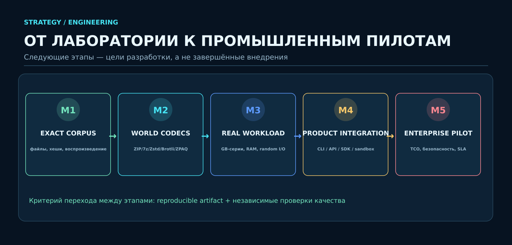

<p align="center"></p>

# SHTENCO · SYNERGY AI COMPRESS

**Исследовательская платформа архивирования: SABF-X · PBM-39X · OMNIA · Gabriel-Horn · GRAAL · TSC-X · NEXUS-UMC**

> [!IMPORTANT]
> **Правило доказуемости:** исторический список из 76 профилей — не доказательство выполнения 76 программ в одном свежем бенчмарке. Движок получает статус **MEASURED** исключительно после нового запуска с сохранённым кодом, источником входного файла, SHA-256, проверкой точного восстановления, замерами упаковки и распаковки. Для неподтверждённых профилей не публикуются выдуманные коэффициенты.

## Статус подтверждения

| Группа | Статус | Доказательство |
|---|---|---|
| Исторический каталог SHTENCO — 76 профилей | **HISTORICAL / NOT A FRESH RUN** | [Frozen Tier-1 registry](compression_lab/frozen_tier1_summary.py) |
| Оригинальные Tier-1 / OMNIA / Gabriel-Horn | **SOURCE PRESENT** | [compression_lab](compression_lab/) |
| SABF-X Speed и PBM-39X Fast V2 | **LOCAL EXPERIMENT, NOT INDEPENDENTLY REVERIFIED HERE** | Нужен воспроизводимый отчёт с версией исходника и корпусом |
| Мировые кодеки — прежний набор из 38 профилей | **SEPARATE HISTORICAL BENCHMARK** | [Исторический отчёт](benchmarks/extended_80plus_20261020/README_RU.md) |
| Полный единый тест 76 + V2 + WORLD на реальных файлах | **NOT YET VERIFIED** | Не публиковать общий рейтинг до появления полного run manifest и артефактов |

## Методика общего SHTENCO vs WORLD

Для каждого **фактически доступного исполняемого** движка на одинаковых неизменённых реальных файлах измеряются полный размер архива, длительность упаковки, длительность распаковки, коэффициент `original_bytes / archive_bytes`, пиковая RAM (когда измерена), статус byte-for-byte + SHA-256 и число повторов. Не прошедшие, отсутствующие и прерванные по тайм-ауту профили остаются в таблице со статусами **FAIL / NOT_RUN / TIMEOUT**, а не исключаются молча.

**Единая эффективность SAEI** с явно выбранной ценой времени:

```
SAEI(V) = original_bytes / (archive_bytes + V*(compress_seconds + decompress_seconds))
V = 10 * 1024 * 1024 bytes / second (illustrative CPU-cost scenario)
```

SAEI зависит от выбранного V. Публикуются также исходные метрики и чувствительность к V. Компрессоры-ансамбли, использующие Zstd/Brotli, помечаются как маршрутизаторы сторонних backend-кодеков — это важно для оценки собственного технологического вклада.

[](assets/readme/architecture-v2.svg)

## Репозиторий и исходники

- [Tier-1 original source](compression_lab/shtenco_tier1_engines.py)
- [Tier-1 portfolio V2](compression_lab/shtenco_tier1_v2.py)
- [Tier-1 V2.1](compression_lab/shtenco_tier1_v21.py)
- [Gabriel-Horn original source](compression_lab/gabriel_horn_engine.py)
- [Unified executable benchmark](compression_lab/benchmark_unified_tier1.py)
- [Real infrastructure log benchmark](compression_lab/benchmark_real_datacenter_20261020.py)
- [Historical frozen evidence](compression_lab/frozen_tier1_summary.py)
- [Preserved previous README with earlier tables and illustrations](docs/archive/README_PRE_EVIDENCE_REFRESH_20261020.md)

## Изображения и презентация

<p align="center"></p>
<p align="center"></p>

> [!NOTE]
> Старые таблицы намеренно убраны **из главного README**, чтобы отдельно проведённые испытания, синтетические и реальные корпуса, исторические 76 профилей и неисполненные движки не выглядели единым доказанным рейтинговым тестом. Исходный README сохранён целиком по ссылке выше; новые числовые таблицы должны генерироваться только из результатов реального исполнения.

**Лицензия:** proprietary; см. [LICENSE](LICENSE).
