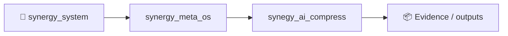
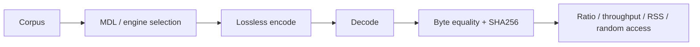

# SHTENCO AI Compress

Единый репозиторий технологий архивации и lossless-сжатия SHTENCO.

## Состав

- EGD-256, SABF-X, HACE-X, TSC-X, AMCE-100X;
- UMC-256 и MDL-маршрутизация;
- Graph-AI Compression V5.2 и GRAAL-IGC;
- **Gabriel Horn Codec (`SGH1`)**: многомасштабный lifting, significance-shells, дедупликация, random access и surface-aware MDL;
- BIP39, Arithmetic, rANS, Huffman, Graph Delta;
- Tier-1 движки и Matrix web-приложение;
- воспроизводимые benchmark, round-trip и SHA-256 тесты.

Активные файлы хранятся в `compression_lab/`, CI — в `.github/workflows/`.

## Gabriel Horn

```python
from compression_lab.gabriel_horn_engine import GabrielHornEngine

engine = GabrielHornEngine(profile="max")
archive = engine.compress(source)
assert engine.decompress(archive) == source
fragment = engine.decompress_range(archive, 1000, 5000)
```

Математика, формат контейнера и ограничения описаны в `compression_lab/README_GABRIEL_HORN.md`.

## Точный корпусный benchmark

```bash
python compression_lab/benchmark_gabriel_corpus.py \
  --size 16384 \
  --repeats 3 \
  --warmups 1 \
  --engines raw,gabriel-max,zstd-19,brotli-11,graal-igc \
  --output compression_lab/output_gabriel_corpus
```

Benchmark измеряет фактический размер архива, encode/decode throughput, peak RSS,
стоимость случайного доступа и access amplification. Каждое измерение выполняется
в новом процессе и принимается только после byte equality и SHA-256.

Исторический `UMC-256` добавляется только при наличии его точного snapshot-модуля;
другие UMC-движки не подставляются под это имя. Полная методология описана в
`compression_lab/GABRIEL_CORPUS_METHODOLOGY.md`.

`source_snapshot` — неизменяемый Git-snapshot commit `c681ec94fe5194156b71fc304035f7aaff4d2327` из прежнего репозитория. В нём сохранены все исторические compression-файлы, тесты и поколения V3/V4/V5.2/Tier-1. После клонирования с доступом к приватному `Shtenco/agi_olga` выполните:

```bash
git submodule update --init source_snapshot
```

Проект графового ИИ нового поколения, включая версию из статьи, проходившую AGI-бенчмарки, хранится отдельно в `Shtenco/agi_olga`.


<!-- SYNERGY-FEDERATION-PASSPORT:START -->
---

## 🧭 SYNERGY federation passport

**Домен:** 🗜️ Compression / archival substrate  
**Архитектурный родитель:** [`synergy_meta_os`](https://github.com/Shtenco/synergy_meta_os)  
**Архитектурный корень:** [`synergy_system`](https://github.com/Shtenco/synergy_system)



Эта диаграмма фиксирует место в документационной федерации. Реальная code/runtime dependency должна подтверждаться отдельными артефактами.

### Навигация

- [📚 Атлас всех 75 репозиториев](https://github.com/Shtenco/synergy_system/blob/main/docs/SYNERGY_REPOSITORY_ATLAS.md)
- [🧾 Машиночитаемый registry](https://github.com/Shtenco/synergy_system/blob/main/registry/SYNERGY_REPOSITORIES.json)
- [🧭 SYNERGY SYSTEM](https://github.com/Shtenco/synergy_system)

### Evidence rule

`GREEN` присваивается только воспроизводимым утверждениям. Исследовательский код, диаграмма или заявленная метрика без проверяемого artifact trail остаются `R&D/CANDIDATE`.

<!-- SYNERGY-FEDERATION-PASSPORT:END -->

---

# 🗜️ Глубокий доказательный паспорт AI Compress

## Реальный benchmark/evidence слой

Проект уже имеет CI для Gabriel corpus, unified Tier-1 и real-12B probes, методологии, exact benchmark runners и round-trip tests.



## Главный evidence invariant

Compression claim принимается только после exact round-trip. Большой ratio без byte equality не является результатом.

## Особая граница 12B experiments

NEXUS DWE/RVQ real-12B evidence относится к конкретному storage/compression experiment и не должно автоматически трактоваться как lossless compression всей интеллектуальной способности модели.

## Следующий рубеж

frozen multi-corpus suite → external codec baselines → CPU/RAM/random-access cost → reproducible environment manifest → independent rerun.
