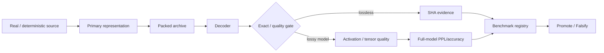

# 🗜️ SYNERGY AI Compress — verified compression research dossier

> **Статус:** 🔬 R&D / CANDIDATE evidence platform.
> **Проверено по фактическому `main`, benchmark evidence, tests и federation contract:** 29.09.2026.
> **Сильная сторона:** repository сохраняет не только положительные результаты, но и формальные falsification verdicts.

## 1. 🎯 Задача

`synegy_ai_compress` исследует сверхсильное сжатие моделей/структурированных данных, но с жёсткой границей:

```text
small representation != useful model
compression ratio     != preserved inference quality
archive produced      != lossless unless exact round-trip passes
benchmark claim       != general capability
```

Главная инженерная цель — искать representations, которые одновременно проходят storage, reconstruction и downstream quality gates.

## 2. 📦 Фактический состав

```text
synegy_ai_compress/
├── benchmarks/
│   ├── NEXUS_DWE_REAL_12B_EVIDENCE.md
│   └── NEXUS_RVQ_REAL_12B_EVIDENCE.md
├── compression_lab/
│   ├── benchmark_*.py
│   ├── gabriel_horn_engine.py
│   ├── nexus_dwe_real_12b.py
│   ├── nexus_omega_store_probe.py
│   ├── shtenco_tier1_*.py
│   ├── synergy_contracts.py
│   ├── tests...
│   └── results/
├── docs/
├── .github/workflows/
├── MATERIALIZE_COMPRESSION_SNAPSHOT.sh
├── MIGRATION_MANIFEST.md
└── source_snapshot
```

Это полноценный experiment/evidence repository, не README-only shell.

## 3. 🔗 Federation contract: exact archive identity

`compression_lab/synergy_contracts.py`:

```text
CONTRACT_ID = synergy.archive.evidence/v1
AUTHORITY   = compression_identity
```

`archive_evidence_payload` требует:

[
restored == source
]

иначе сразу `ValueError`.

Для successful lossless evidence сохраняются:

- source SHA-256;
- archive SHA-256;
- codec id;
- original bytes;
- archive bytes;
- `round_trip_verified=true`;
- benchmark id;
- random-access capability flag.

## 4. 🛡️ Lossless invariant

Каноническое условие:

[
D(C(X)) = X
]

byte-for-byte, плюс:

[
SHA256(D(C(X))) = SHA256(X)
]

Это сильнее проверки «файл открылся» или semantic similarity.

## 5. 🧪 Exact benchmark methodology

`BENCHMARK_ALL_SYSTEMS_METHODOLOGY.md` фиксирует:

- discovery всех unique engines;
- 11 deterministic datasets по seed `20260730`;
- 32,768-byte datasets;
- GitHub Actions Ubuntu 24.04;
- Python 3.11;
- pinned requirements;
- `PYTHONHASHSEED=0`;
- warm-up;
- 3 timed reps;
- `perf_counter_ns`;
- GC controlled during timing;
- medians + min/max;
- exact decompression correctness for every repetition.

Rankings разделены по метрикам; repository прямо не называет один engine «универсально лучшим».

## 6. 📊 Real 12B DWE falsification

Evidence file pins:

```text
Model: mistralai/Mistral-Nemo-Base-2407
Revision: 2045759120154383da48ee84ce4bf2f90cc6ec1f
BF16 checkpoint bytes: 24,495,564,800
```

Whole-row DWE hypothesis давала экстремальные structural ratios вплоть до сотен/тысяч ×, но real-weight quality разрушалась.

Representative corrected 2-bit results имели:

- low row cosine;
- very high NMSE on several tensors;
- large random-activation relative L2 error.

Verdict сохранён явно:

**FALSIFIED as a whole-row 16–128 prototype compressor.**

Это хороший scientific behavior: маленький representation size не был выдан за breakthrough после failed quality gate.

## 7. 🚨 Literal 2-bit quantizer bug

Evidence фиксирует конкретный bug: signed centroid value затем clamp'ился в `[0,3]`, уничтожая negative components.

Это отдельный lesson:

```text
bit width claim != valid quantizer
```

Numeric encoding должен проверяться на sign/range semantics, а не только packed size.

## 8. 🧪 Block PQ / Residual VQ follow-up

Следующий real-weight experiment tested block PQ/RVQ.

Structural examples:

- PQ8×1 ~1.50 bpw;
- PQ16×1 ~0.75 bpw;
- RVQ16×2 ~1.50 bpw;
- RVQ32×2 ~0.75 bpw;
- RVQ64×2 ~0.38 bpw.

Это существенно реалистичнее whole-row DWE geometry.

Но quality verdict остаётся осторожным:

> geometry works better, quality still insufficient in 0.38–1.50 bpw region.

## 9. 📉 Entropy-coding falsification

Index entropy для K=256 observed примерно 7.9–8.0 bits.

Поэтому hypothesis, что Huffman снимет 30–50% index bytes, **не подтверждена**.

Observed secondary lossless gains были modest — примерно 1.05×–1.22× в этом experiment.

Вывод: primary numeric representation важнее optimistic entropy wrapper.

## 10. 🏗️ Архитектура research pipeline



## 11. 📥 Inputs / 📤 Outputs

Inputs include:

- byte corpora;
- model weight tensors;
- pinned model revision;
- codec configuration;
- calibration data for future activation-aware methods.

Outputs:

- compressed archives;
- restored bytes;
- ratios/bpw;
- encode/decode timings;
- tensor distortion;
- activation relative error;
- machine-readable benchmark results;
- explicit verdict.

## 12. 🛡️ Claim boundaries

```text
projected representation size != actual full-model artifact
tensor cosine                 != perplexity
random activation error       != downstream benchmark
PPL preservation              != task accuracy
compression ratio             != speedup
lossless wrapper gain         != primary quantization gain
sample evidence               != universal model-family result
```

## 13. ⚠️ Remaining quality gates

Before a lossy LLM compressor is promoted:

1. activation-aware calibration;
2. exact full model materialization;
3. perplexity;
4. downstream accuracy;
5. multiple model families;
6. CPU/GPU memory;
7. tokens/s;
8. decode/runtime overhead;
9. reproducible packing;
10. compare against strong baselines at same bpw.

## 14. 🧪 Existing test/evidence surface

Repository contains dedicated tests for:

- Gabriel/Horn engine;
- exact corpus benchmark;
- Omega store probe;
- Tier1 engines;
- Tier1 V2;
- federation contract.

README does not turn source test files into observed-green CI unless actual run evidence is checked.

## 15. 🛠️ Reproducibility

The repository contains explicit benchmark scripts and pinned methodology rather than one opaque notebook.

A valid run should preserve:

```text
source/model revision
dependency versions
seed
codec config
archive hash
restored hash
timings
quality metrics
verdict
```

For model experiments, external checkpoint access and compute are additional prerequisites.

## 16. 🗺️ Repository map

| Area | Role |
|---|---|
| `compression_lab/` | engines, benchmark runners, tests |
| `benchmarks/` | curated real-model evidence |
| `compression_lab/results/` | raw/derived results |
| `synergy_contracts.py` | archive identity contract |
| `docs/` | legacy/provenance |
| `.github/workflows/` | CI/experiments |
| `MIGRATION_MANIFEST.md` | snapshot/migration provenance |

## 17. 🔗 Место в SYNERGY

Producer of archive/compression evidence for:

- `synergy_meta_os`;
- `synergy_net`;
- model/runtime repositories.

Compression authority is limited to representation/archive identity and benchmark evidence; it does not get model-quality authority without downstream tests.

## 18. 📊 Evidence maturity

| Layer | Status |
|---|---|
| lossless round-trip contract | ✅ |
| deterministic benchmark methodology | ✅ |
| real 12B sample evidence | ✅ |
| negative/falsification evidence | ✅ |
| whole-row DWE | ❌ FALSIFIED |
| naive PQ/RVQ geometry | 🟡 better, insufficient quality |
| full-model PPL at target bpw | ❌ |
| end-to-end runtime speed | ❌ |
| universal SOTA claim | ❌ |

## 19. 🚀 Roadmap

1. activation-aware distortion;
2. additive/residual codebooks under fixed bit budget;
3. outlier residuals;
4. full-model materialization;
5. PPL/accuracy;
6. strong baseline parity;
7. runtime kernels;
8. memory/tokens-s benchmark;
9. observed federation archive evidence.

## 20. 🛑 Что project НЕ утверждает

- that 100×–2000× structural arithmetic preserves an LLM;
- that DWE passed — it was falsified;
- that Huffman saves 30–50% here — it did not;
- that sub-1bpw model is usable without full-model validation;
- that compression automatically accelerates inference.

---

[🧭 SYNERGY SYSTEM](https://github.com/Shtenco/synergy_system) · [📚 Atlas](https://github.com/Shtenco/synergy_system/blob/main/docs/SYNERGY_REPOSITORY_ATLAS.md)
