<p align="center">
  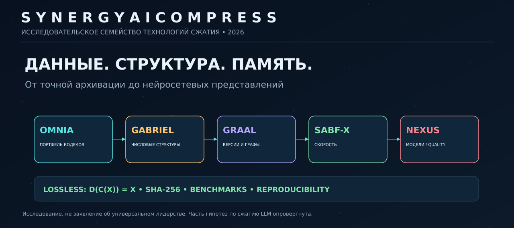
</p>

<p align="center"><strong>Научно-инженерная система сжатия · 76 исследовательских профилей · проверяемый lossless · графы версий · LLM compression R&amp;D</strong></p>
<p align="center">
  <a href="#что-мы-строим">Миссия</a> · <a href="#семейство-технологий">Технологии</a> · <a href="#реальные-бенчмарки">Бенчмарки</a> · <a href="#сжатие-нейросетей">Нейросети</a> · <a href="#перспективы-для-еаэс-и-мира">ЕАЭС и мир</a> · <a href="#запуск-и-воспроизводимость">Запуск</a>
</p>

> [!IMPORTANT]
> **Репозиторий — исследовательская лаборатория.** Подтверждённые результаты ограничены конкретными файлами, настройками, оборудованием и датой замеров. Здесь **нет** доказательства среднего сжатия в 30× на произвольных пользовательских данных, универсального превосходства над Zstandard/Brotli/7-Zip или сохранения точности LLM при сверхнизкой разрядности.

**Статус:** lossless experimental code + historical evidence; LLM weight compression — исследование с отрицательными результатами. **Права:** [собственническая лицензия](LICENSE); публичный доступ к коду не означает открытую лицензию.

## Что мы строим

Обычный архиватор выбирает один алгоритм, а затем пытается применить его ко всем файлам. **SYNERGY AI COMPRESS** исследует другой инженерный подход: анализировать тип структуры, выбирать подходящий проверяемый маршрут сжатия и выпускать воспроизводимый архив с доказательством того, что исходные данные можно получить назад.

Это **семейство** технологий, потому что цифровые данные принципиально различаются: логи отличаются от исходников, гладкие числовые ряды — от случайных байтов, последовательные версии модели — от независимых файлов, а веса нейросети — от архива документов.

Цель — оптимизировать не только размер, но и скорость, потребление памяти, стоимость эксплуатации, выборочный доступ, безопасность и **достоверность восстановления**. Система не нарушает информационно-теоретические пределы: некоторые файлы невозможно уменьшить без потерь, и для них корректным выбором является RAW.

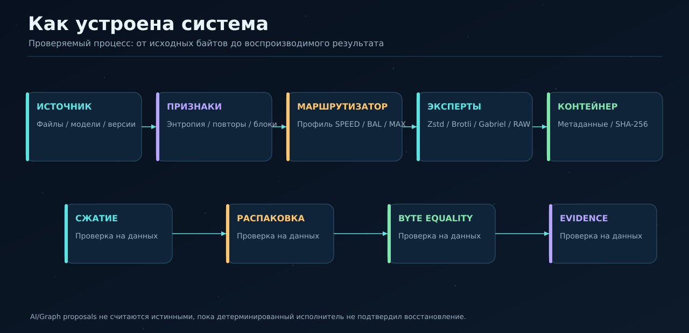

### Одна формула, без которой результат не считается результатом

Для компрессии без потерь:

$$D(C(X))=X$$

и проверка:

```python
archive = encoder.compress(source)
restored = encoder.decompress(archive)
assert restored == source
assert sha256(restored).digest() == sha256(source).digest()
```

**Коэффициент сжатия** = `исходные байты / архивные байты`. **Экономия пространства** = `1 − архивные/исходные`. Это разные показатели; уменьшение файла с 100 до 20 МБ означает **5×**, или **80%** экономии, а не «80×».

## Семейство технологий

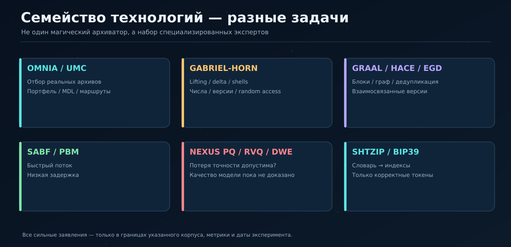

| Семейство | Главная идея | Где применимо | Статус |
|---|---|---|---|
| **OMNIA Tier-1 v2** | Портфель кодеков с проверкой фактического размера и обратимости | Смешанные данные / выбор лучшего маршрута | Исполняемый исследовательский движок |
| **Gabriel-Horn SGH1** | Обратимые delta/XOR/lifting-предикторы, битовые оболочки, индекс | Числовые ряды, версии, выборочные диапазоны | Исполняемый прототип |
| **GRAAL-IGC / Graph-AI** | Блочные графы, структурные связи и версии | Частично похожие объекты, история изменений | Исполняемые исследования |
| **SABF-X / PBM-39X** | Скоростное распознавание и выбор маршрута | Быстрая архивация небольших блоков | Измерены профили Tier-1 |
| **UMC-256 / HACE / EGD-256** | Модели смеси экспертов, каскады, tournament | Исследование соотношения ratio/latency | Исторические/активные профили |
| **SHTZIP / BIP39** | Обратимое кодирование *только* допустимых словаря токенов | Структурированный мнемонический текст | Ограниченная специализированная ветвь |
| **NEXUS DWE / PQ / RVQ** | Квантование/кодовые книги весов нейросетей | Потенциальное сокращение хранения моделей | **Проверка качества не пройдена** |

**Подробно для инженеров:** [полный каталог технологий](docs/TECHNOLOGY_FAMILY_RU.md), [архив источников](MIGRATION_MANIFEST.md), [технический инвентарь](compression_lab/TIER1_V2_TECHNOLOGY_INVENTORY.md).

### OMNIA: не волшебное сжатие, а выбор экспертов

1. Исследуются статистические признаки потока: энтропия, доля печатных символов и нулей, повторяемость, корреляции, блочная похожесть.
2. Выбираются допустимые варианты преобразования: RAW, Zstd, Brotli, zlib, LZMA, обратимые delta/shuffle/XOR, специализированные эксперты.
3. Сравнивается **полная цена** архива с заголовком и метаданными, а не только размер исходного payload.
4. Кандидат допускается только при точном восстановлении.
5. Профиль **SPEED** ограничивает перебор, **BALANCED** подбирает компромисс, **MAX** перебирает больше комбинаций ради размера.

Это важная причина, почему OMNIA на зафиксированном корпусе достигает сильных результатов: он может выбрать **Brotli на тексте**, **delta+Zstd на версиях**, **RLE+Zstd на разреженных данных**, **Gabriel на структурных бинарных блоках** и **RAW на случайных байтах**. Но портфельный результат нельзя автоматически переносить на другой корпус.

### Gabriel-Horn: предсказуемая структура и контролируемая точность

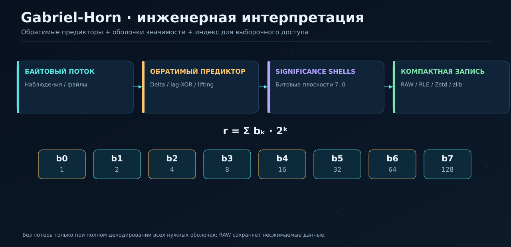

Gabriel не хранит «бесконечный объём информации в конечном файле». Название описывает математическую метафору **ядро плюс остаточные оболочки**. Реальный движок применяет конечные обратимые преобразования, затем кодирует остаток и хранит индекс блоков. При полном декодировании восстанавливаются **все исходные биты**; при частичном — может формироваться приблизительный preview, который нельзя выдавать за lossless.

```python
from compression_lab.gabriel_horn_engine import GabrielHornEngine

codec = GabrielHornEngine(profile="balanced")
packed = codec.compress(source_bytes)
assert codec.decompress(packed) == source_bytes
fragment = codec.decompress_range(packed, 1000, 5000)
```

Его сильная сторона на одном сохранённом тесте — гладкие `int32` и связанные версии. Ограничения — дорогой перебор в MAX и не всегда дешёвый random access. [Методика Gabriel](compression_lab/GABRIEL_CORPUS_METHODOLOGY.md) · [Глубокая спецификация](compression_lab/README_GABRIEL_HORN.md).

## Реальные бенчмарки

> [!NOTE]
> Ниже **воспроизведены сохранённые результаты** от 30 июля 2026 года. Новые независимые измерения на другой машине при подготовке этой страницы **не выполнялись**. Ссылки на исходные методики, проверки и исторический отчёт сохранены для аудита.

### Испытание A — Unified Tier-1 v2

**11 фиксированных наборов по 32 768 байт каждый:** код, JSON-графы, телеметрия, повторяющийся текст, версии, разреженные веса, структуры, image-like данные, BIP39, смесь и псевдослучайные байты. Дата: **2026-07-30**. В отчёте учтено **76 уникальных систем**, из них **14 активных** повторно измерены на всех 11 файлах, то есть **154/154 точных проверок**.

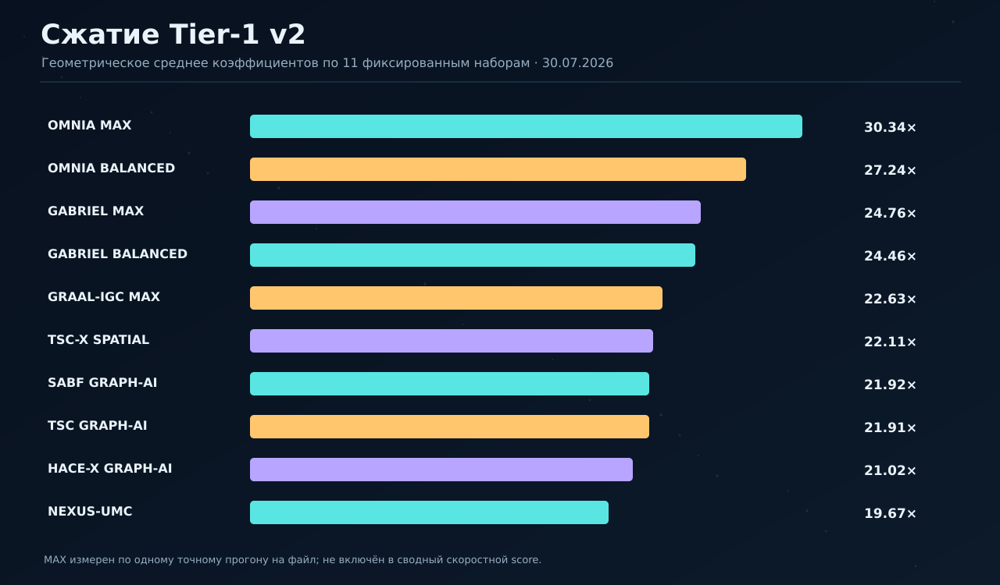

| Профиль | Геометрическое среднее × | Примечание |
|---|---:|---|
| **OMNIA MAX** | **30,336×** | Один точный замер на набор, не скоростной победитель |
| **OMNIA Balanced** | **27,235×** | 1 прогрев + 3 замера |
| Gabriel-Horn MAX | 24,760× | Один точный замер на набор |
| Gabriel-Horn Balanced | 24,459× | 1 + 3 |
| GRAAL-IGC MAX | 22,634× | 1 + 3 |
| TSC-X Spatial | 22,115× | 1 + 3 |

**Что такое геометрическое среднее?** Если на одном файле достигнуто 100×, а на другом 1×, геометрическое среднее равно 10×. Это **не** означает, что объединённый набор файлов уменьшился в 10 раз: для общего архива нужно сложить исходные и архивные байты. Кроме того, корпус **специально фиксированный и преимущественно структурированный** — не репрезентативная выборка всех файлов в мире.

**Источник:** [первичный отчёт Unified Tier-1](compression_lab/results/UNIFIED_TIER1_V2_20260730.md), [методика всех систем](compression_lab/BENCHMARK_ALL_SYSTEMS_METHODOLOGY.md), [машинная копия ключевого рейтинга](data/historical_tier1_ratio_evidence.csv).

### Испытание B — реальная цена скорости

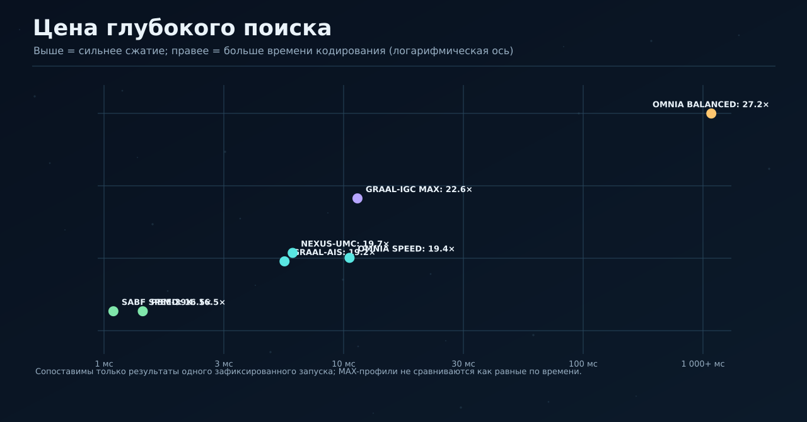

На тех же 11 небольших файлах сохранённый отчёт указывает **SABF-X Speed**: 16,501× и 1,642 мс **суммарного времени кодирования**. У **OMNIA Balanced**: 27,235×, но 9 837,787 мс. Это разные позиции на кривой Парето — «самое маленькое» не равно «самое быстрое». Эти миллисекунды нельзя без отдельного теста экстраполировать на многогигабайтные потоки, NVMe, сеть или одновременную нагрузку.

### Испытание C — Gabriel против Brotli, Zstd и UMC

**Другой корпус**: семь синтетических потоков плюс четыре реальных файла, всего **139 762 байта**. Здесь можно считать корректный общий коэффициент как `сумма исходных байтов / сумма архивных байтов`.

| Кодек | Архив, байт | Экономия | Кодирование, MiB/s |
|---|---:|---:|---:|
| **Brotli-11** | **33 728** | **75,87%** | 1,206 |
| Gabriel-Horn MAX | 35 372 | 74,69% | 0,010 |
| UMC-256 MAX | 35 983 | 74,25% | 0,059 |
| GRAAL-IGC MAX | 36 483 | 73,90% | 8,307 |
| Zstandard-19 | 36 813 | 73,66% | 4,155 |

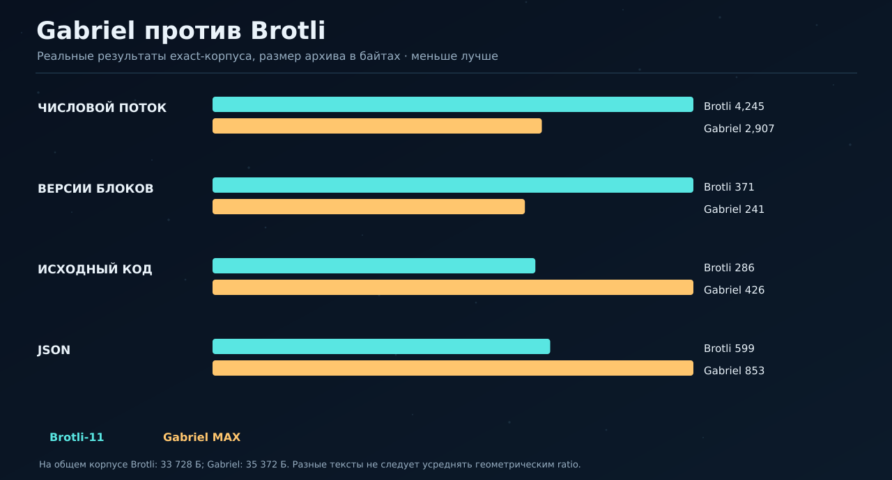

Для `numeric_smooth_i32` Gabriel дал **2 907 байт** против **4 245 байт** у Brotli — меньше на ~31,5%. Для `source_code` картина обратная: Brotli **286 байт**, Gabriel **426 байт**. На псевдослучайных 8 192 байтах Gabriel записал **8 258**: 66 байт накладных расходов, а не экономию. Сохранённый источник отмечает, что на общем корпусе Brotli лучше, а Gabriel MAX на Python исключительно медленен.

[Полный отчёт и таблицы по 11 файлам](compression_lab/results/gabriel_umc_exact_20260730/README.md) · [CSV с точными измерениями](compression_lab/results/gabriel_umc_exact_20260730/gabriel_corpus_summary.csv) · [копия сведённых данных](data/gabriel_corpus_20260730.csv).

### Что в бенчмарках нужно проверять обязательно

| Метрика | Как трактовать |
|---|---|
| **Размер архива, байт** | Включая все заголовки и индексы |
| **Геометрическое среднее ratio** | Усредняет относительное сжатие **по файлам**, не их общий размер |
| **Общий ratio** | `Σ исходных байтов / Σ архивных байтов` |
| **Encode/decode throughput** | MiB/s, фиксированная машина и параметры |
| **Random access** | Микросекунды запроса, затронутые байты и реальный API |
| **RAM / Peak RSS** | Пиковая память всего процесса, включая Python/runtime |
| **Round-trip** | Байтовое равенство плюс SHA-256 |
| **TCO** | Стоимость хранения, передачи, вычислений и эксплуатации |

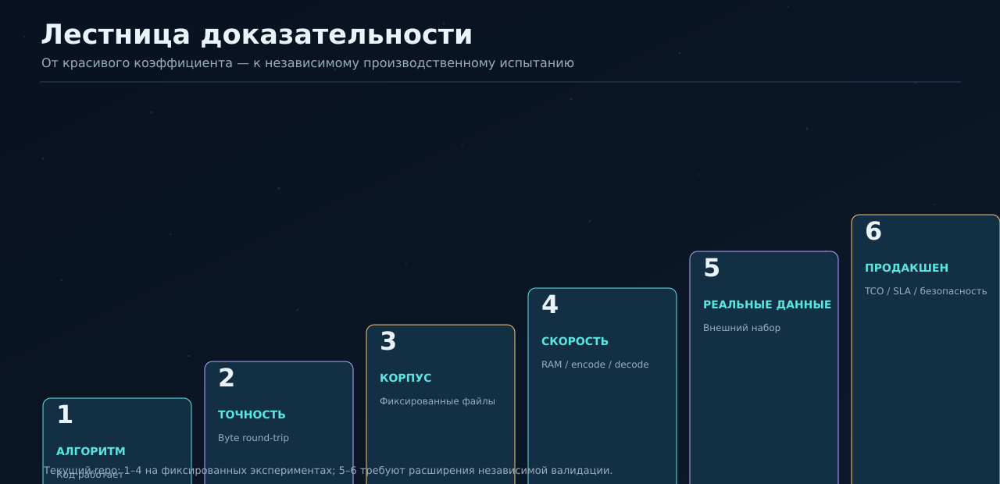

[**Большой технический разбор всех результатов и типичных ловушек измерения →**](docs/BENCHMARKS_EXPLAINED_RU.md)

## Сжатие нейросетей

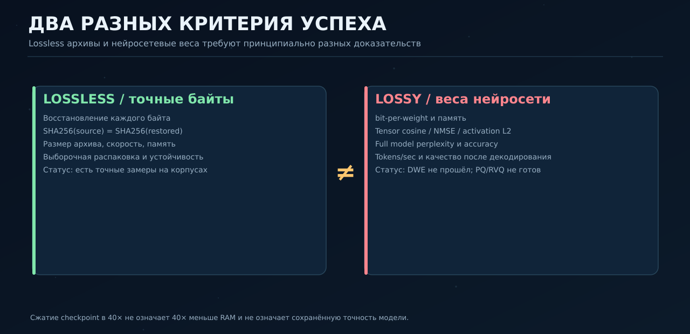

### Почему «модель в 1000 раз меньше» ничего не доказывает

Для LLM **архивный размер** — только один критерий. Нейросеть должна сохранить поведение. Нужны проверки tensor error, activation error, perplexity, downstream accuracy, RAM/VRAM и tokens/s. Неверная модель, занимающая 10 мегабайт, не является конкурентом рабочей модели в 24 гигабайта.

### DWE: гипотеза проверена и опровергнута

Зафиксирован эксперимент на **реальных BF16-фрагментах Mistral-Nemo-Base-2407** с pinned revision. Структурная арифметика whole-row DWE показывала от **405× до 2445×** для отдельных параметризаций, но ошибки реальных весов оказались разрушительными. Протокол однозначен: **whole-row DWE K=16–128 FALSIFIED**. Это не 2445-кратное рабочее сжатие модели.

### PQ/RVQ: менее экстремальное представление, но качество всё ещё недостаточно

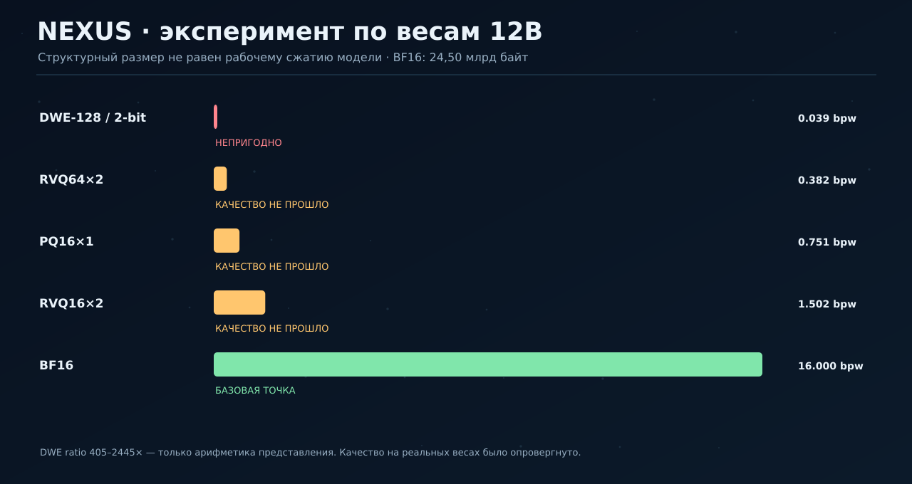

| Метод | Структурная плотность | Арифметическая экономия относительно BF16 | Подтверждённое качество модели |
|---|---:|---:|---|
| PQ8×1 | 1,501 bpw | 10,7× | Не пройдено |
| PQ16×1 | 0,751 bpw | 21,3× | Не пройдено |
| RVQ32×2 | 0,754 bpw | 21,2× | Не пройдено |
| RVQ64×2 | 0,382 bpw | 41,9× | Не пройдено |

Эти размеры рассчитаны по структуре кодовых книг и индексов; они **не являются** результатом успешного end-to-end inference. В реальных образцах entropy индексных кодов была около **7,9–8,0 бит**, а дополнительное lossless-сжатие упаковки — лишь около **1,05×–1,22×**. Предположение, что обычный Huffman снимет 30–50% индексных байтов, не подтвердилось.

[**Полный DWE-протокол →**](benchmarks/NEXUS_DWE_REAL_12B_EVIDENCE.md) · [**PQ/RVQ-протокол →**](benchmarks/NEXUS_RVQ_REAL_12B_EVIDENCE.md) · [**План правильной проверки качества LLM →**](docs/TECHNOLOGY_FAMILY_RU.md).

## Перспективы для ЕАЭС и мира

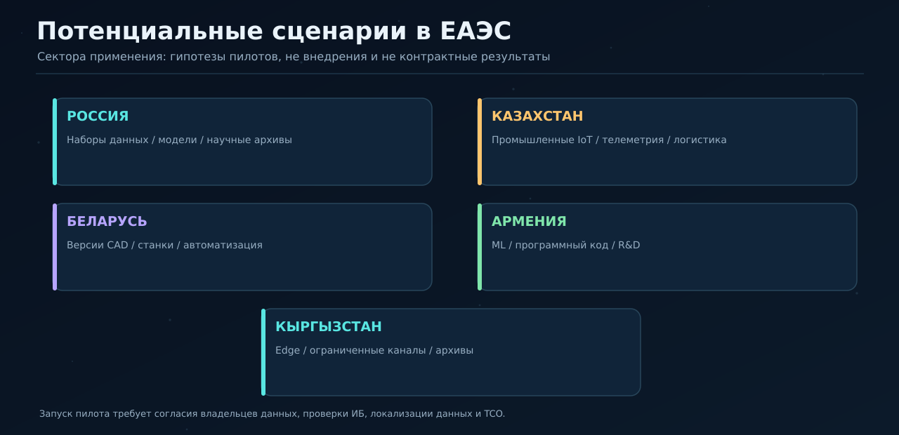

**Потенциальные рынки**: архивы предприятий и госорганизаций, версионное хранение инженерной документации, промышленные IoT-потоки, научные данные, модели ИИ, распределённое резервное копирование, логистика и межведомственный электронный документооборот. Это **направления пилотов**, не подтверждённые клиенты, продажи или внедрения.

Евразийская экономическая комиссия и UNECE обсуждали в 2026 году трансграничный электронный обмен документами и цифровые транспортные коридоры [UNECE, 04.06.2026](https://unece.org/trade/events/developing-electronic-document-exchange-cross-border-multimodal-supply-chains). Для России, Казахстана, Беларуси, Армении и Кыргызстана это создаёт **сценарий исследования совместимых архивов** — но не означает, что стандарты требуют данный кодек.

Мировой потенциал связан с хранением ML-моделей, стоимостью репликации и ограничениями вычислений. В отчёте [IEA *Energy and AI*](https://www.iea.org/reports/energy-and-ai/executive-summary) отмечено ~415 ТВт·ч мирового потребления ЦОД в 2024 году. Это контекст спроса на оптимизацию вычислений, **не оценка экономии электричества от SYNERGY Compress**.

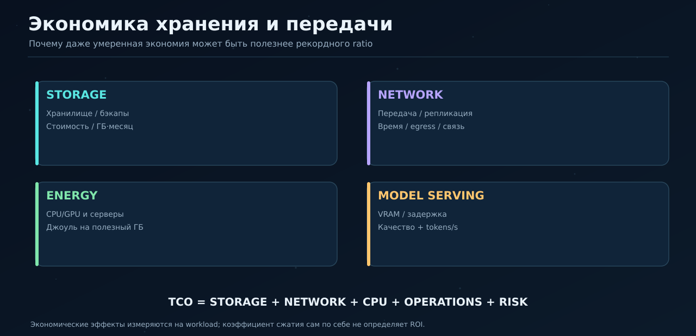

### Что реально нужно доказать перед продажей

Коммерческий эффект = снижение **общей стоимости владения**, а не только размера `.zip`. В пилоте нужно измерять: цену дисков/облака, сетевой трафик, стоимость CPU/GPU, часы работы, восстановление после аварии, риски несовместимости, безопасность контейнеров и цену миграции. На высокоэнтропийных/уже сжатых данных ROI может быть нулевым или отрицательным.

Для всех стран ЕАЭС обязателен отдельный анализ требований к персональным данным, криптографии, трансграничной передаче, импортозамещению и закупкам. Нельзя автоматически считать один правовой режим действительным во всех пяти странах.

[**Подробный анализ рынков ЕАЭС, мира, типов заказчиков, моделей продукта и экономики пилотов →**](docs/EAES_GLOBAL_MARKET_RU.md)

## Роль в экосистеме SYNERGY

Слой компрессии должен обеспечивать **архивную идентичность** и доказательство того, что содержимое восстановимо. Он не получает полномочий самостоятельно подтверждать полезность нейросети или финансовый результат другой системы.

- **SYNERGY EURASIAN / Financial OS:** доказуемое хранение проектных файлов, версий моделей и цифровых артефактов.
- **NEXUS / Science / AI:** модели, чекипойнты, экспериментальные датасеты и воспроизводимые manifest.
- **SYNERGY NET / META OS:** возможный транспорт и кэширование блочного контента.
- **Государственные и корпоративные архивы:** потенциальные workload-пилоты, требующие отдельной аттестации и тестов безопасности.

См. [федеративный контракт `synergy.archive.evidence/v1`](compression_lab/synergy_contracts.py), [каталог технологий](compression_lab/TIER1_V2_TECHNOLOGY_INVENTORY.md).

## Запуск и воспроизводимость

> [!WARNING]
> Копировать код и запускать его можно **только при наличии соответствующего разрешения**: [LICENSE](LICENSE) является собственнической лицензией и не предоставляет автоматически разрешения третьим лицам.

Для авторизованного разработчика с доступом к репозиторию:

```bash
python -m venv .venv
source .venv/bin/activate     # Windows: .venv\Scripts\activate
pip install -r compression_lab/requirements_v4.txt

# Компонентные тесты
python -m pytest -q compression_lab/test_gabriel_horn_engine.py \
  compression_lab/test_tier1_engines.py compression_lab/test_tier1_v2.py

# Зафиксированный бенчмарк (тяжёлый MAX, может работать долго)
python -m compression_lab.benchmark_unified_tier1 --help

# Понятный минимальный пример Gabriel
python - <<'PYCODE'
from compression_lab.gabriel_horn_engine import GabrielHornEngine
b = b'A' * 16384
c = GabrielHornEngine(profile='speed')
z = c.compress(b)
assert c.decompress(z) == b
print('bytes:', len(b), '->', len(z))
PYCODE
```

**GitHub Actions:** [Unified Tier-1](.github/workflows/unified_tier1_v2_benchmark.yml), [Gabriel exact](.github/workflows/gabriel-corpus-benchmark.yml), [smoke](.github/workflows/tier1-smoke.yml). Результаты старых Actions **не означают**, что свежий `main` автоматически прошёл сегодня все тесты. Для принятия новой версии необходим новый зафиксированный запуск и хеши артефактов.

### Структура репозитория

```text
synegy_ai_compress/
├── compression_lab/            # кодеки, тесты, benchmark runners
│   ├── gabriel_horn_engine.py
│   ├── shtenco_tier1_v2.py
│   ├── benchmark_unified_tier1.py
│   └── results/               # исторические точные измерения
├── benchmarks/                # реальная проверка весов Mistral 12B
├── data/                      # копии опубликованных чисел
├── docs/                      # подробные разборы / provenance
├── assets/readme/             # визуальные схемы и графики
├── scripts/                   # проверка целостности презентации
├── .github/workflows/         # бенчмарки и проверки
├── source_snapshot            # исторический gitlink / submodule
└── LICENSE                   # все права сохранены владельцем
```

## Стадия развития и следующие задачи

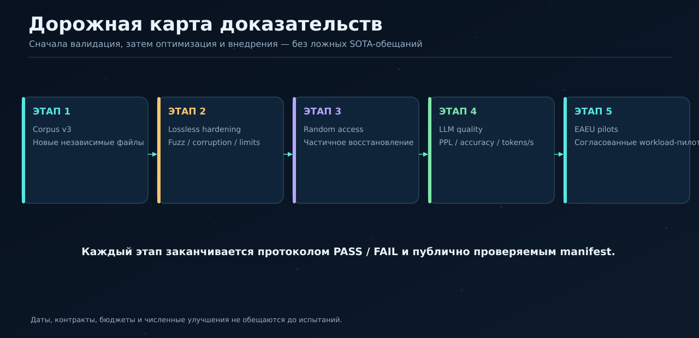

**Дальнейший результат должен быть сильнее красивого README:** независимый корпус из больших, несжатых и уже сжатых файлов; воспроизводимые тесты безопасности и fuzz; профили random access и потокового восстановления; сравнение **ZIP, 7-Zip/LZMA, Zstd, Brotli** с одинаковыми настройками; а для моделей — тесты perplexity, accuracy и фактической VRAM/tokens-s.

[План валидации, пороги, негативные тесты и реестр утверждений](docs/VALIDATION_AND_CLAIMS_RU.md) · [Дорожная карта R&D → продукт](docs/ROADMAP_RU.md).

---

<p align="center"><strong>ЦЕННОСТЬ НЕ В КРАСИВОМ ЧИСЛЕ, А В ДОКАЗАТЕЛЬСТВЕ ВОССТАНОВЛЕНИЯ, КАЧЕСТВА И ЭКОНОМИЧЕСКОЙ ПОЛЬЗЫ.</strong></p>
<p align="center"><sub>© 2026 Evgeniy Koshtenko · Proprietary / All Rights Reserved · Результаты не являются гарантиями будущей эффективности</sub></p>