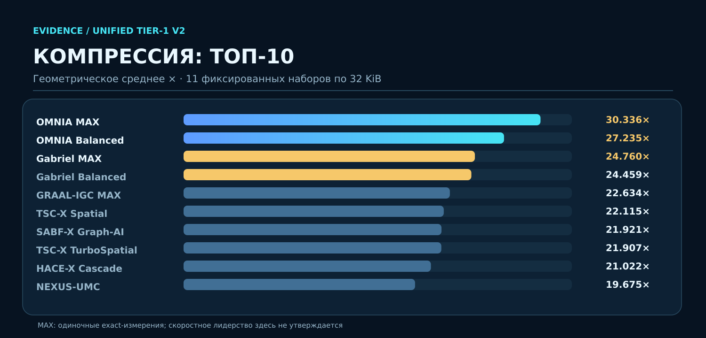
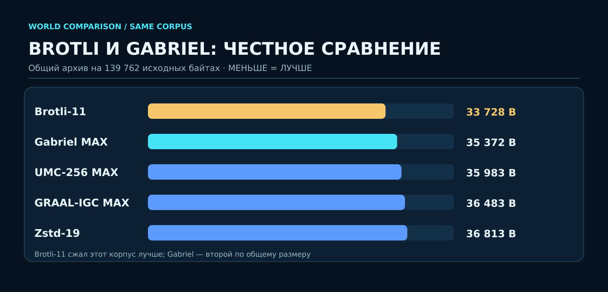
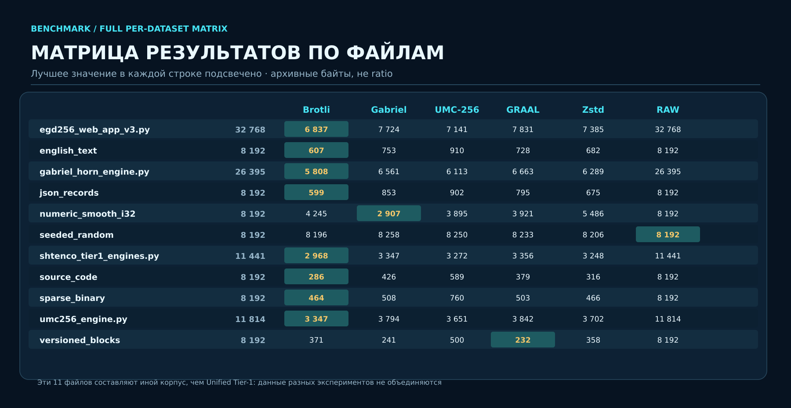
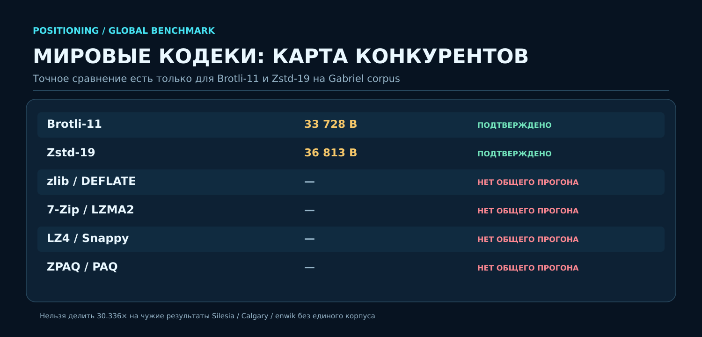
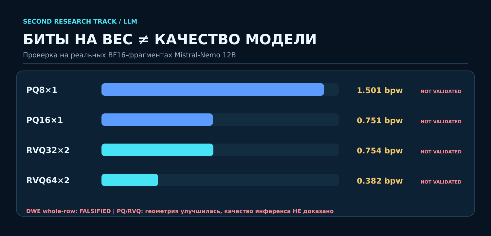
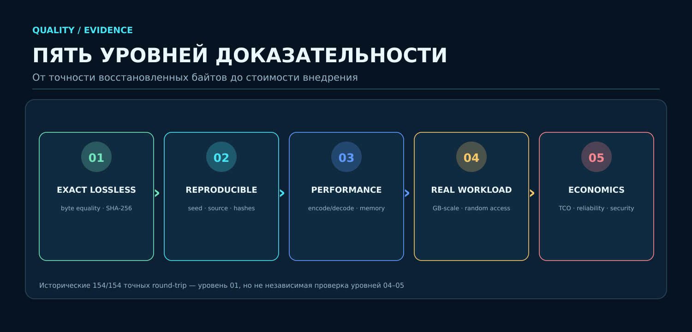

<p align="center"></p>

> [!TIP]
> **НОВЫЙ БОЛЬШОЙ БЕНЧМАРК — 20.10.2026.** Независимо исполнены **38 профилей мировых кодеков × 11 одинаковых наборов = 418/418 PASS**, byte-for-byte + SHA-256. Исторические **76 SHTENCO профилей** хранятся отдельно; опубликован GitHub Actions runner для объединённого реестра **до 114 профилей** с маркировкой происхождения. Заявленные **52×** пока требуют точного воспроизведения. [Полная таблица 38 кодеков, 418 строк, исходники и графики](benchmarks/extended_80plus_20261020/README_RU.md).


<p align="center"><strong>Архивы нового поколения · Универсальная маршрутизация кодеков · Структурные и версионные данные · Сжатие нейросетей R&amp;D</strong></p>

<p align="center">
<a href="#возможности">Возможности</a> · <a href="#семейство-технологий">Семейство</a> · <a href="#результаты-бенчмарков">Бенчмарки</a> · <a href="#мировые-архиваторы">Конкуренты</a> · <a href="#рынки-еаэс-и-мира">ЕАЭС и мир</a> · <a href="#как-запустить">Запуск</a>
</p>

> [!IMPORTANT]
> **Инженерно-исследовательский проект, не универсально лучший архиватор мира.** Результаты из исторических бенчмарков от **30.07.2026** относятся к заданным корпусам и настройкам. Сжатие нейросетей DWE/PQ/RVQ не прошло необходимых проверок качества. Репозиторий частный, лицензия **PROPRIETARY / ALL RIGHTS RESERVED**; права и исходные движки сохранены.

## Сначала главное

| **76** исследовательских систем в реестре | **30,335995×** OMNIA MAX | **154/154** проверенных active exact-cases | **13+** направлений R&D и точной архивации |
|:---:|:---:|:---:|:---:|
| Исторический агрегированный инвентарь | Геометрическое среднее на 11 фиксированных файлах | Измерения current active 14 × 11, по отчёту | Отдельные семейства движков и архитектур |

**SYNERGY AI COMPRESS — не просто ZIP-замена.** Это семейство программных и математических методов хранения данных, которое исследует, **какое кодирование подходит конкретной структуре** и сколько на самом деле стоят байты, время CPU, память, обращения к архиву и восстановление исходного объекта.


## Независимый локальный бенчмарк — 20 октября 2026

> [!IMPORTANT]
> **Это новый отдельный тест 30 стандартных профилей, а НЕ свежий прогон 76 собственных SHTENCO движков.** Применён специально синтезированный корпус из 11 файлов по 32 768 байт, отличный от июльского Tier-1 корпуса. Результаты нельзя напрямую сравнивать с историческими 30,335995× OMNIA или заявленными 52×. Значения являются геометрическими средними индивидуальных коэффициентов, а не отношением общей суммы байтов.

- Исполнено **30 профилей × 11 файлов = 330/330 точных восстановлений PASS**; после декодирования проверены полное равенство исходных байтов и SHA-256.
- Среда: **Python 3.13.5 / Linux x86-64**, локальный запуск 2026-10-20; единственный замер кодирования на каждом файле, **скоростные рейтинги не заявляются**.
- 11 категорий: repeated text, source code, English text, JSON records, telemetry CSV, version snapshots, sparse weights, structured binary, smooth numeric, image-like, random bytes.
- Генератор использовал seed `20261020`, объём каждого файла — **32 KiB**. Поскольку корпус содержит сильно повторяющиеся искусственные данные, геометрический средний коэффициент может быть очень высоким. Для производственных выводов требуются реальные независимые файлы и повторяемые испытания.

| Место | Реально исполненный профиль | Геом. средний коэффициент | Отношение суммарных байтов | Exact |
|---:|---|---:|---:|---:|
| 1 | Brotli-11 | **69.881×** | 9.048× | 11/11 |
| 2 | Brotli-9 | 66.343× | 8.891× | 11/11 |
| 3 | Brotli-7 | 66.307× | 8.878× | 11/11 |
| 4 | Brotli-5 | 65.449× | 8.865× | 11/11 |
| 5 | Zstd-19 | 63.900× | 9.027× | 11/11 |
| 6 | Brotli-3 | 63.260× | 8.754× | 11/11 |
| 7 | Zstd-9 | 61.702× | 8.856× | 11/11 |
| 8 | Zstd-15 | 61.524× | 8.835× | 11/11 |
| 9 | Zstd-6 | 61.194× | 8.793× | 11/11 |
| 10 | Zstd-1 | 59.122× | 8.792× | 11/11 |

**Статус полного локального бенчмарка SHTENCO:** не выполнен — приватные исходники собственного семейства недоступны целиком в этой локальной среде (сетевой clone завершился ошибкой разрешения хоста); их исторические показатели не подменены измерениями сторонних кодеков. Полный отдельный CSV и исходный скрипт доступны в исследовательской сессии, но не представлены в этом репозитории как опубликованные артефакты.

## Реальные инфраструктурные логи: SHTENCO против международных кодеков (20.10.2026)

> [!WARNING]
> **Результаты нового прогона ещё НЕ получены.** Не интерпретировать предыдущий искусственный бенчмарк 30 внешних профилей как SHTENCO-vs-world или как данные дата-центров. В этой среде нельзя напрямую клонировать приватный репозиторий или скачивать внешний корпус; поэтому я подготовил исполняемый протокол GitHub Actions, но не выдаю непроверенные цифры.

Для свежего сравнения добавлен [исполняемый бенчмарк](compression_lab/benchmark_real_datacenter_20261020.py) и настроен [CI workflow](.github/workflows/benchmark_80plus_20261020.yml). Он загружает небольшие реальные опубликованные фрагменты системных логов [Loghub](https://github.com/logpai/loghub) (HDFS, BGL, OpenStack, Hadoop, Spark, Zookeeper, Linux), сохраняет URL и SHA-256 каждого корпуса, сравнивает доступные нативные движки Tier-1/OMNIA/Gabriel-Horn с Brotli, Zstandard, LZ4, XZ, bzip2 и zlib, проверяет byte-for-byte round-trip. Некоторые наборы Loghub получены на экспериментальных системах; это **не** прямой доступ к приватным данным промышленных дата-центров.

Предусмотренные артефакты после **успешного завершения**: `compression_lab/real_datacenter_20261020/summary.csv`, `per_file.csv`, `corpus_manifest.json`, `README.md`. Пока эти файлы не созданы подтверждённым запуском, **не публикуется рейтинг победителей**. Из 76 уникальных исторических названий не все представляют сегодня отдельно исполняемые профили; отсутствующие должны иметь статус NOT_RUN, а не искусственно заполненные коэффициенты.

## Возможности

В разных режимах семейство предоставляет:

1. **Портфельное сжатие:** OMNIA выбирает между известными кодеками и обратимыми преобразованиями и сохраняет результат, только если round-trip подтверждён.
2. **Специализированное структурное кодирование:** Gabriel-Horn использует предикторы, XOR, lifting и оболочки значимости.
3. **Ускоренные режимы:** SABF-X и PBM-39X уменьшают затраты на выбор и кодирование небольших блоков.
4. **Графы версий:** GRAAL-IGC и Graph-AI исследуют связи, chunking, diff и точные ссылки на ранее сохранённые блоки.
5. **Выборочные фрагменты:** `decompress_range()` у Gabriel; это реальный API, но не автоматически лучший random access на всех режимах.
6. **Криптографическое подтверждение восстановления:** исходные байты, хеш, архив, кодек, версия и протокол испытания.
7. **Эксперименты по сжатию весов моделей:** отдельная R&D-ветвь с количественными проверками качества и сохранёнными отрицательными результатами.


### Что даёт использование нескольких кодеков

В одном и том же проекте могут встречаться почти несжимаемые видеоархивы, высокоповторяющиеся журналы событий, гладкие числовые массивы и снимки версий. Маршрутизатор **не обещает один универсальный алгоритм**, а проверяет несколько полезных путей: Brotli для текста, Zstd/дельты для версий, RLE для разреженных структур, Gabriel для отдельных структурированных блоков и RAW для энтропийных данных. Это **измеренная стратегия для фиксированного корпуса**, но ещё не доказанное преимущество на всех корпоративных массивах.

## Семейство технологий

| Технология | Суть | Сильный проверяемый аспект | Ограничение |
|---|---|---|---|
| **OMNIA MAX** | Портфельная минимизация фактических байтов | **30,335995×** geomean на 11 фиксированных файлах | Большой перебор, высокое время |
| **OMNIA Balanced** | Выбор кодеков с ограничением работы | **27,235040×** на том же корпусе | Нужен новый stress / GB benchmark |
| **SABF-X Speed** | Быстрая адаптация блоков | **1,642 мс**, 11×32 KiB в сохранённом тесте | Не является throughput на больших файлах |
| **Gabriel-Horn** | Числовые предикторы, оболочки, блоки | **2907 байт** `numeric_smooth_i32` vs Brotli **4245** | MAX-кодирование медленное |
| **GRAAL-IGC** | Структуры, версии, графы | **232 байта** `versioned_blocks`, лучше Gabriel 241 | Зависит от реальных межверсийных связей |
| **UMC-256** | Смесь экспертов, MDL | Часть подтверждённого корпуса | RAM/latency могут расти |
| **HACE / EGD / TSC / SHTZIP** | Каскады, маршрутизация, пространственные и специальные преобразования | Отдельные экспериментальные участники | Нет доказанного превосходства на всех форматах |
| **NEXUS DWE / PQ / RVQ** | Сжатие весов ИИ | Зафиксированы структурные оценки и ошибки | **Full-model quality не пройдена** |

**Технические источники:** [инвентарь v2](compression_lab/TIER1_V2_TECHNOLOGY_INVENTORY.md), [исходники](compression_lab/), [Gabriel-Horn API](compression_lab/README_GABRIEL_HORN.md), [большой каталог](docs/TECHNOLOGY_FAMILY_RU.md).

## Результаты бенчмарков



### Unified Tier-1 V2: полная опубликованная таблица TOP-10 по сжатию

| № | Кодек / профиль | Geometric mean × | Протокол |
|---:|---|---:|---|
| 1 | OMNIA MAX | **30.335995×** | single exact |
| 2 | OMNIA Balanced | **27.235040×** | warm-up + 3 |
| 3 | Gabriel MAX | **24.759551×** | single exact |
| 4 | Gabriel Balanced | **24.459013×** | warm-up + 3 |
| 5 | GRAAL-IGC MAX | **22.633934×** | warm-up + 3 |
| 6 | TSC-X Spatial | **22.114639×** | warm-up + 3 |
| 7 | SABF-X Graph-AI | **21.920991×** | frozen exact |
| 8 | TSC-X TurboSpatial | **21.907299×** | frozen exact |
| 9 | HACE-X Cascade | **21.021521×** | frozen exact |
| 10 | NEXUS-UMC | **19.674641×** | warm-up + 3 |

**Примечание:** геометрическое среднее коэффициентов по отдельным файлам не равно общему отношению `Σ original bytes / Σ archive bytes`. 30,336× нельзя интерпретировать как универсальное сжатие всех пользовательских документов. Исходные 11 файлов **специально фиксированы и структурированы**.

### Скорость и коэффициент: отдельная оптимизационная ось


| № | Профиль | Ratio | Авторский score | 11 файлов, encode ms |
|---:|---|---:|---:|---:|
| 1 | SABF-X SPEED | 16.500986× | 118.317876 | 1.642 |
| 2 | PBM-39X | 16.500986× | 96.452109 | 2.517 |
| 3 | SABF-X Balanced | 17.093538× | 20.359616 | 9.286 |
| 4 | GRAAL-AIS | 19.206956× | 14.675943 | 19.796 |
| 5 | NEXUS-UMC | 19.674641× | 12.318960 | 22.290 |
| 6 | TSC-X Spatial | 22.114639× | 7.863649 | 31.763 |
| 7 | OMNIA SPEED | 19.403181× | 4.621028 | 50.985 |
| 8 | GRAAL-IGC MAX | 22.633934× | 4.429738 | 57.206 |
| 9 | OMNIA Balanced | 27.235040× | 0.285008 | 9 837.787 |
| 10 | Gabriel SPEED | 12.445315× | 0.105844 | 1 325.464 |

Указанный `score` повторяет поле исторического отчёта. Время указано для набора **11 небольших файлов**, а не в качестве скорости на терабайтных архивах. Heavy MAX-профили исключены из ранжирования по этому score.

### Мировое сравнение: Brotli / Gabriel / UMC / GRAAL / Zstd



**Независимый от Unified Tier-1 фиксированный корпус:** 11 файлов, 139 762 исходных байта. Здесь есть прямое парное сравнение с мировыми кодеками, а не два чужих бенчмарка с несопоставимыми датасетами.

| Кодек | Полный архив | Общий ratio | Экономия | Encode MiB/s | Decode MiB/s | Peak RSS MiB | Random access µs | Amplification | Native range |
|---|---:|---:|---:|---:|---:|---:|---:|---:|---:|
| Brotli-11 | 33 728 | 4.1438× | 75.87% | 1.206 | 269.83 | 36.11 | 14.852 | 16.0× | нет |
| Gabriel MAX | 35 372 | 3.9512× | 74.69% | 0.010 | 496.56 | 36.07 | 16.505 | 16.0× | да |
| UMC-256 MAX | 35 983 | 3.8841× | 74.25% | 0.059 | 239.15 | 101.43 | 38.377 | 16.0× | нет |
| GRAAL-IGC MAX | 36 483 | 3.8309× | 73.90% | 8.307 | 846.98 | 35.70 | 11.026 | 16.0× | нет |
| Zstd-19 | 36 813 | 3.7965× | 73.66% | 4.155 | 439.30 | 35.45 | 3.956 | 16.0× | нет |
| RAW | 139 762 | 1.0000× | 0.00% | 5653.039 | 21701.39 | 34.57 | 0.371 | 16.0× | нет |

**Победа Brotli на этом корпусе — реальный факт:** архив 33 728 байт против 35 372 у Gabriel. При этом Gabriel лучше на гладких `int32` и обладает native range API. **Текущий Gabriel MAX чрезмерно дорог при сжатии на Python** и пока не предназначен как массовая замена Brotli.

### Полная матрица по всем 11 файлам



| Набор | Input B | Brotli-11 | Gabriel MAX | UMC-256 | GRAAL-IGC | Zstd-19 | RAW |
|---|---:|---:|---:|---:|---:|---:|---:|
| `egd256_web_app_v3.py` | 32 768 | 6 837 | 7 724 | 7 141 | 7 831 | 7 385 | 32 768 |
| `english_text` | 8 192 | 607 | 753 | 910 | 728 | 682 | 8 192 |
| `gabriel_horn_engine.py` | 26 395 | 5 808 | 6 561 | 6 113 | 6 663 | 6 289 | 26 395 |
| `json_records` | 8 192 | 599 | 853 | 902 | 795 | 675 | 8 192 |
| `numeric_smooth_i32` | 8 192 | 4 245 | 2 907 | 3 895 | 3 921 | 5 486 | 8 192 |
| `seeded_random` | 8 192 | 8 196 | 8 258 | 8 250 | 8 233 | 8 206 | 8 192 |
| `shtenco_tier1_engines.py` | 11 441 | 2 968 | 3 347 | 3 272 | 3 356 | 3 248 | 11 441 |
| `source_code` | 8 192 | 286 | 426 | 589 | 379 | 316 | 8 192 |
| `sparse_binary` | 8 192 | 464 | 508 | 760 | 503 | 466 | 8 192 |
| `umc256_engine.py` | 11 814 | 3 347 | 3 794 | 3 651 | 3 842 | 3 702 | 11 814 |
| `versioned_blocks` | 8 192 | 371 | 241 | 500 | 232 | 358 | 8 192 |

**Ключевые случаи:** `numeric_smooth_i32`: Gabriel **2907 B**, Brotli **4245 B**. `versioned_blocks`: GRAAL **232 B**, Gabriel **241 B**, Brotli **371 B**. `source_code`: Brotli **286 B**, Gabriel **426 B**. `seeded_random`: лучшая стратегия — **RAW**, не имитация сжатия.

**[ПОЛНЫЙ ДОСТУПНЫЙ БЕНЧМАРК: TOP-10 + TOP-speed + все кодеки + 11×6 таблица](docs/FULL_VERIFIED_BENCHMARK_TABLES_RU.md)** · [CSV таблицы](data/) · [оригинальный протокол](compression_lab/results/UNIFIED_TIER1_V2_20260730.md) · [методика](compression_lab/BENCHMARK_ALL_SYSTEMS_METHODOLOGY.md).

> [!CAUTION]
> Сводный реестр содержит **76 систем**, но полный per-file CSV всех 76 × 11 результатов из старого Actions artifact **не включён в текущий Git checkout**. Здесь опубликованы **все конкретные числа, сохранившиеся в двух основных human-readable отчётах**, а неподтверждённые результаты не дорисованы.

## Мировые архиваторы



| Мировое решение | Сильная область | Что у SYNERGY потенциально отличается | Доказанное сравнение |
|---|---|---|---|
| [ZIP / DEFLATE](https://www.rfc-editor.org/rfc/rfc1951) | совместимость, массовый обмен | структурные предикторы, графы версий, адаптивный выбор | **Нужен единый прогон** |
| [Zstandard](https://github.com/facebook/zstd) | скоростное сжатие, популярный формат | структурные маршруты + специальные byte transforms | **Zstd-19** испытан на Gabriel corpus |
| [Brotli](https://github.com/google/brotli) | text/code/JSON, web content | портфель OMNIA + числовые предикторы Gabriel | **Brotli-11 выиграл общий Gabriel corpus** |
| [7-Zip / LZMA2](https://www.7-zip.org/) | тяжёлое словарное сжатие, solid archives | отдельные версии, индексированные структуры | **Нужен единый прогон** |
| [LZ4](https://github.com/lz4/lz4) / [Snappy](https://github.com/google/snappy) | очень быстрый поток и декодирование | выбираемые режимы ratio/speed и структурные эксперты | **Нужен единый прогон** |
| [ZPAQ](https://mattmahoney.net/dc/zpaq.html) / PAQ | контекстное архивирование, высокое сжатие | портфельная логика + специализированные numeric routes | **Нужен единый прогон** |
| gzip / zlib | зрелые переносимые форматы | маршрутизация + обратимые предикторы | **Нужен единый прогон** |

Некоторые мировые продукты, например 7-Zip, тоже поддерживают несколько кодеков и контейнеров. Поэтому **портфельность сама по себе не уникальна**. Ценность SYNERGY должна подтверждаться на **определённом типе нагрузки**, по размеру, времени, RAM, безопасности, выборочному доступу и стоимости хранения.

Для ориентира у Zstd есть внешний тест на **корпусе Silesia** [в официальной документации](https://github.com/facebook/zstd#benchmarks), но цифры оттуда **нельзя численно сопоставлять** с результатом 30,336× на нашем другом корпусе.

**[Подробная инженерная сравнительная экспертиза против мировых решений →](docs/ADVANTAGES_VS_GLOBAL_CODECS_RU.md)** · **[Протокол независимого benchmark →](docs/BENCHMARK_REPRODUCIBILITY_PROTOCOL_RU.md)**.

## Сжатие ИИ-моделей: отдельная инженерная ветвь



Есть два разных обещания:

- **Lossless**: каждый исходный байт должен восстановиться точно — `D(C(X)) == X` и SHA-256.
- **Lossy LLM weights**: модель должна сохранить требуемое поведение; размер без качества ничего не доказывает.

Данные взяты с реальных BF16-образцов **Mistral-Nemo-Base-2407**, ревизия зафиксирована. Whole-row DWE K=16–128 **опровергнут** (falsified), несмотря на впечатляющие структурные оценки размера. Для PQ/RVQ числа **10,7×–41,9×** отражают расчёт плотности представления, **не успешную end-to-end модель**: расхождение активаций и отсутствие full-model PPL/accuracy пока блокируют production-применение. Huffman-экономия 30–50% на индексах тоже не подтверждена.

[Evidence DWE](benchmarks/NEXUS_DWE_REAL_12B_EVIDENCE.md) · [Evidence PQ/RVQ](benchmarks/NEXUS_RVQ_REAL_12B_EVIDENCE.md) · [отдельная методология проверки](docs/VALIDATION_AND_CLAIMS_RU.md).

## Рынки ЕАЭС и мира


**ЕАЭС:** Россия, Казахстан, Беларусь, Армения и Кыргызстан. Возможные направления пилотов — корпоративные архивы, промышленные временные ряды, геоданные, телеком, цифровые двойники, конструкторские версии, корпоративные реестры, модели ИИ и резервное копирование научных данных. **Это карта потенциальных применений, а не перечень клиентов.**

Международные сценарии: data centers, enterprise storage, model registries, object storage, industrial IoT, edge devices, scientific/research archiving, software artifact reproducibility. Нужны собственные workload-датасеты, реальные бюджеты CPU/RAM, процедура восстановления и контроль безопасности контейнеров.

Коммерческое преимущество определяет **TCO, а не только коэффициент сжатия**: Storage + Traffic + Compute + Restore Time + Reliability + Engineering Cost. На уже сжатых или высокоэнтропийных данных экономия может быть отрицательной.

**[Подробная стратегия применения в ЕАЭС и мире, отрасли, модели лицензирования и критерии пилотов](docs/EAES_AND_GLOBAL_COMMERCIAL_POSITIONING_RU.md)**.

## Проверяемость и честность результатов



Каждое положительное утверждение должно ссылаться на эксперимент с настройками, версиями, хешами, датой и восстановленными байтами. **Нельзя** подменять геометрическое среднее общим размером, байты архива битами на вес или оценку памяти работающей нейросети её arithmetical packed size.

- Исторический отчёт: [`UNIFIED_TIER1_V2_20260730.md`](compression_lab/results/UNIFIED_TIER1_V2_20260730.md).
- Результаты Gabriel: [`gabriel_umc_exact_20260730/README.md`](compression_lab/results/gabriel_umc_exact_20260730/README.md).
- Exact-contract: [`synergy.archive.evidence/v1`](compression_lab/synergy_contracts.py).
- Многомерный протокол: [`BENCHMARK_ALL_SYSTEMS_METHODOLOGY.md`](compression_lab/BENCHMARK_ALL_SYSTEMS_METHODOLOGY.md).

## Как запустить

> [!WARNING]
> **PROPRIETARY LICENSE** — разрешение на использование, распространение и доработку регулируется правообладателем. Наличие доступа к репозиторию не означает публичной лицензии.

Для авторизованного разработчика:

```bash
python -m venv .venv
# Linux / macOS:
source .venv/bin/activate
# Windows:
# .venv\Scripts\activate
python -m pip install -r compression_lab/requirements_v4.txt

# Тесты на существующих кодеках
python -m pytest -q compression_lab/test_gabriel_horn_engine.py compression_lab/test_tier1_engines.py compression_lab/test_tier1_v2.py

# Основной тестовый инструментарий
python -m compression_lab.benchmark_unified_tier1 --help

# Gabriel round-trip
python - <<'PYEXAMPLE'
from compression_lab.gabriel_horn_engine import GabrielHornEngine
x = b'ABCD' * 4096
codec = GabrielHornEngine(profile='speed')
y = codec.compress(x)
assert codec.decompress(y) == x
print(len(x), len(y))
PYEXAMPLE
```

**CI/Actions:** [unified](.github/workflows/unified_tier1_v2_benchmark.yml), [gabriel](.github/workflows/gabriel-corpus-benchmark.yml), [tier1 smoke](.github/workflows/tier1-smoke.yml). Публикуемые здесь числа — **исторические результаты**, не новый CI-green от этого документационного коммита.

## Дорожная карта


1. Экспортировать/восстановить полный исторический артефакт результатов **76 систем**; не подменять отсутствующие метрики догадками.
2. Создать **единый внешний benchmark** на одинаковых реальных промышленных корпусах с ZIP, 7-Zip LZMA2, Zstd, Brotli, LZ4, Snappy, ZPAQ; размер, время, RAM, доступ, crash recovery.
3. Отдельно оценить низколатентные и high-ratio профили и инженерную цену обхода 100 вариантов.
4. Сделать выборочный доступ, высокопроизводительные декодеры и ускорение наиболее дорогих Python-путей.
5. Проводить корпоративные пилоты с измеримой себестоимостью хранения и критериями отказа от решения.
6. Для LLM: activation-aware learning, full-checkpoint materialization, PPL, downstream accuracy, VRAM и tokens/s.

### Архив исходных исследований

- [`docs/TECHNOLOGY_FAMILY_RU.md`](docs/TECHNOLOGY_FAMILY_RU.md)
- [`docs/BENCHMARKS_EXPLAINED_RU.md`](docs/BENCHMARKS_EXPLAINED_RU.md)
- [`docs/EAES_GLOBAL_MARKET_RU.md`](docs/EAES_GLOBAL_MARKET_RU.md)
- [`docs/ROADMAP_RU.md`](docs/ROADMAP_RU.md)
- [`docs/FULL_VERIFIED_BENCHMARK_TABLES_RU.md`](docs/FULL_VERIFIED_BENCHMARK_TABLES_RU.md)
- [`docs/ADVANTAGES_VS_GLOBAL_CODECS_RU.md`](docs/ADVANTAGES_VS_GLOBAL_CODECS_RU.md)
- [`docs/BENCHMARK_REPRODUCIBILITY_PROTOCOL_RU.md`](docs/BENCHMARK_REPRODUCIBILITY_PROTOCOL_RU.md)

**© 2026 Evgeniy Koshtenko. Все права защищены.** [LICENSE](LICENSE). Этот README не является публичной офертой и не гарантирует будущих результатов.