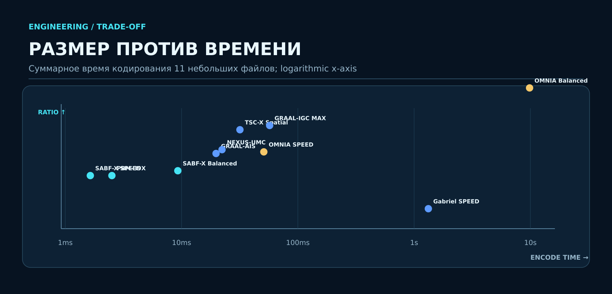

<p align="center"></p>

# SHTENCO SYNERGY AI COMPRESS

**Международная компрессионная платформа · Universal Archiving · Version-Aware Storage · Enterprise Data Optimization**

<p align="center"></p>

> [!IMPORTANT]
> **Единственный источник сравнительных цифр на этой странице:** предоставленные владельцем пакеты исходников Tier-1 и Unified Tier-1 V2. В первом — 69 профилей и журналы/таблицы, во втором — объединённый реестр 76 профилей и оригинальные Python-файлы. Здесь **не выдаются** прошлые посторонние тесты на Linux/PyTorch или 38 мировых режимов за результаты этих двух архивов. Результаты получены из приложенных к исходным пакетам протоколов. Полный новый контрольный прогон планируется отдельно.

<p align="center"></p>

## Executive summary

| 76 профилей | 14 current-кодеков | 62 записи из исходного набора | 11 наборов данных |
|:---:|:---:|:---:|:---:|
| Сводный реестр, включая мировые кодеки и RAW | Исполнение из архива Unified Tier-1 V2 | Сохранённые результаты исходного набора | Детерминированный корпус по 32768 байт |

**Сжатие измерено вместе со временем:** исходный архив содержит `all_systems_rows.csv`, `all_systems_summary.csv`, `environment.json`; второй — `current_systems_rows.csv`, `combined_systems_summary.csv`, `SOURCE_COMMITS.txt`. Метрики приводятся с происхождением, а набор A и current не становятся сопоставимым свежим speed-test от их объединения.

## Основные технологии

| Семейство | Роль | Применимость |
|---|---|---|
| **SABF-X Speed / Balanced** | Быстрое Zstd-кодирование и выбор преобразований | Логи, быстрые бэкапы, горячее хранение |
| **PBM-39X** | Потоковая архивация с опциональным BIP39-маршрутом | Структурные текстовые словари, стандартные данные |
| **OMNIA Speed / Balanced / MAX** | Маршрутизация нескольких кодеков по размеру и вычислительным затратам | Offline / cold storage; MAX требует контроля CPU |
| **Gabriel-Horn** | Обратимые lifting, XOR, shells, индекс блоков | Структурные данные, выборочное восстановление |
| **GRAAL / TSC-X / NEXUS-UMC** | Version-aware transforms, byte planes и смесь экспертов | Версионные объекты, структурные бинарные данные |

<p align="center"></p>

## SHTENCO vs WORLD — полный проверяемый реестр 76 профилей

**Строки ниже — фактическая сводка из присланного архива Unified Tier-1 V2**, отсортированная по геометрическому среднему коэффициенту. `current` относится к 14 профилям Unified V2, `набор A` — к 62 записям исходного набора. Каждый показатель времени — суммарное время обработки 11 файлов, миллисекунды, **из исходного CSV**. Тестовый корпус структурирован и сгенерирован детерминированно, он **не является** выборкой реальных корпоративных данных.

| № | Профиль | Источник | Сжатие × | Encode ms | Decode ms |
|---:|---|---|---:|---:|---:|
| 1 | SHTENCO OMNIA TIER1 V2 MAX | current | 30.336 | 52497 | 35 |
| 2 | SHTENCO OMNIA TIER1 V2 BALANCED | current | 27.235 | 9838 | 36 |
| 3 | SHTENCO GABRIEL-HORN TIER1 MAX | current | 24.760 | 78084 | 40 |
| 4 | SHTENCO GABRIEL-HORN TIER1 BALANCED | current | 24.459 | 30241 | 39 |
| 5 | SHTENCO GRAAL-IGC TIER1 MAX | current | 22.634 | 57 | 6 |
| 6 | SHTENCO TSC-X TIER1 SPATIAL | current | 22.115 | 32 | 5 |
| 7 | SHTENCO SABF-X ULTIMATE GRAPH-AI | набор A | 21.921 | 11143 | 6 |
| 8 | SHTENCO TSC-X TURBOSPATIAL GRAPH-AI | набор A | 21.907 | 1166 | 10 |
| 9 | SHTENCO HACE-X CASCADE GRAPH-AI | набор A | 21.022 | 1965 | 9 |
| 10 | SHTENCO NEXUS-UMC TIER1 | current | 19.675 | 22 | 4 |
| 11 | SHTENCO OMNIA TIER1 V2 SPEED | current | 19.403 | 51 | 2 |
| 12 | SHTENCO DDR-X GRAPH | набор A | 19.214 | 658 | 2 |
| 13 | SHTENCO GRAAL-AIS TIER1 | current | 19.207 | 20 | 6 |
| 14 | SHTENCO CDC-RX GRAPH | набор A | 19.027 | 677 | 2 |
| 15 | SHTENCO UMC-256 MAX | набор A | 18.876 | 20494 | 6 |
| 16 | SHTENCO AMCE-100X GRAPH-AI | набор A | 18.787 | 2127 | 2 |
| 17 | SHTENCO SABF-X ULTIMATE | набор A | 18.720 | 5985 | 9 |
| 18 | SABF-X + ZSTD | набор A | 18.642 | 296 | 7 |
| 19 | SHTENCO RSX RECURSIVE SPATIAL GRAPH-AI | набор A | 18.593 | 1149 | 6 |
| 20 | SHTENCO ODC-XP GRAPH | набор A | 18.508 | 684 | 2 |
| 21 | SHTENCO DMB-39X GRAPH | набор A | 18.478 | 683 | 2 |
| 22 | SHTENCO SECB-39X GRAPH | набор A | 18.448 | 686 | 2 |
| 23 | HYBRID AI COMPRESSION ENGINE | набор A | 18.308 | 4617 | 7 |
| 24 | SHTENCO PECB-39X GRAPH | набор A | 18.262 | 709 | 2 |
| 25 | SHTENCO UMC-256 BALANCED | набор A | 18.189 | 6066 | 4 |
| 26 | SHTENCO ODC-XC GRAPH | набор A | 17.887 | 721 | 2 |
| 27 | SHTENCO BPD-39X GRAPH | набор A | 17.860 | 720 | 2 |
| 28 | SHTENCO UECB-39X GRAPH | набор A | 17.833 | 718 | 2 |
| 29 | SHTENCO ECBC-39 GRAPH | набор A | 17.465 | 825 | 3 |
| 30 | SHTENCO EGD-256 MAX GRAPH-AI | набор A | 17.280 | 2087 | 3 |
| 31 | SHTENCO GRAAL-AIS STORAGE GRAPH-AI | набор A | 17.194 | 1358 | 5 |
| 32 | SHTENCO FAS-256 ATOM STORE GRAPH-AI | набор A | 17.161 | 8864 | 673 |
| 33 | SHTENCO GRAAL-IGC V5.2 | набор A | 17.103 | 827 | 3 |
| 34 | SHTENCO SABF-X TIER1 BALANCED | current | 17.094 | 9 | 0.47 |
| 35 | SHTENCO PBM-39X GRAPH | набор A | 16.973 | 976 | 3 |
| 36 | SHTENCO MICA-39 GRAPH | набор A | 16.973 | 978 | 3 |
| 37 | SABF-X + ZSTD + LZMA9 | набор A | 16.963 | 272 | 8 |
| 38 | SABF-X + LZMA9 | набор A | 16.868 | 254 | 9 |
| 39 | SHTENCO BLOCK_FAST X GRAPH-AI | набор A | 16.760 | 1225 | 3 |
| 40 | SHTENCO SABF-X TIER1 SPEED | current | 16.501 | 1.64 | 0.47 |
| 41 | SHTENCO PBM-39X TIER1 | current | 16.501 | 2.52 | 0.47 |
| 42 | SHTENCO HACE-X CASCADE | набор A | 16.416 | 584 | 20 |
| 43 | SHTENCO AMCE-100X | набор A | 16.337 | 707 | 4 |
| 44 | SHTENCO BAPM-X GRAPH | набор A | 16.055 | 1083 | 3 |
| 45 | BROTLI-11 | набор A | 15.477 | 315 | 1.39 |
| 46 | SHTENCO SABF-X NEURAL SELECTOR | набор A | 15.234 | 334 | 7 |
| 47 | SHTENCO TSC-X TURBOSPATIAL | набор A | 14.444 | 201 | 26 |
| 48 | ZSTD-22 | набор A | 14.070 | 156 | 0.87 |
| 49 | LZMA9 | набор A | 13.966 | 101 | 4 |
| 50 | SHTENCO UMC-256 FAST | набор A | 13.773 | 758 | 1 |
| 51 | ZSTD-3 | набор A | 12.854 | 1.47 | 0.77 |
| 52 | SHTENCO GABRIEL-HORN TIER1 SPEED | current | 12.445 | 1325 | 39 |
| 53 | SHTENCO SABF-X FAST | набор A | 11.727 | 234 | 7 |
| 54 | SHTENCO EGD-256 MAX | набор A | 11.473 | 627 | 5 |
| 55 | BZIP2-9 | набор A | 11.072 | 39 | 8 |
| 56 | GZIP-9 | набор A | 10.938 | 16 | 1 |
| 57 | EGD256 + BROTLI | набор A | 10.684 | 387 | 9 |
| 58 | SHTENCO GRAAL-AIS STORAGE | набор A | 10.560 | 175 | 10 |
| 59 | SHTENCO GABRIEL-HORN TIER1 RANDOM-ACCESS | current | 10.210 | 40732 | 38 |
| 60 | GRAPH DELTA ENCODING | набор A | 10.080 | 89 | 31 |
| 61 | SHTENCO RSX RECURSIVE SPATIAL | набор A | 9.943 | 178 | 14 |
| 62 | EGD256 + LZMA | набор A | 9.888 | 119 | 13 |
| 63 | SHTENCO BLOCK_FAST X | набор A | 9.858 | 89 | 4 |
| 64 | SHTENCO EGD-256 BIP39 GRAPH | набор A | 9.807 | 184 | 13 |
| 65 | EGD256 + ZSTD | набор A | 9.525 | 75 | 8 |
| 66 | SHTENCO EGD-256 RECURSIVE GRAPH | набор A | 8.768 | 225 | 33 |
| 67 | rANS + DICTIONARY | набор A | 2.941 | 83 | 67 |
| 68 | SHTENCO FAS-256 ATOM STORE | набор A | 2.936 | 4027 | 4027 |
| 69 | INTEGER RANGE CODING | набор A | 2.612 | 5604 | 5724 |
| 70 | ADAPTIVE ARITHMETIC CODING | набор A | 1.929 | 6270 | 6388 |
| 71 | ARITHMETIC CODING | набор A | 1.866 | 5824 | 5917 |
| 72 | BIP39 + ARITHMETIC | набор A | 1.863 | 5784 | 5857 |
| 73 | rANS CODING | набор A | 1.853 | 101 | 85 |
| 74 | CANONICAL HUFFMAN | набор A | 1.683 | 334 | 449 |
| 75 | ADAPTIVE HUFFMAN | набор A | 1.679 | 332 | 446 |
| 76 | RAW STORE (reference) | набор A | 1.000 | 0.01 | 0.01 |

**Все 76 записей имеют exact 11/11 в сводном файле архива**, но `набор A` — ранее сохранённые измерения. Рейтинг размера не означает превосходство по CPU; изменение среды и протокола исключает точное сравнение скорости разных runs как одного запуска.

## Международное сравнение — профиль за профилем

| Движок | Тип | Geomean × | Полная упаковка 11 файлов |
|---|---|---:|---:|
| SHTENCO OMNIA V2 MAX | SHTENCO current | 30.336 | 52.50 с |
| SHTENCO OMNIA V2 Balanced | SHTENCO current | 27.235 | 9.84 с |
| SHTENCO GRAAL-IGC MAX | SHTENCO current | 22.634 | 57 мс |
| SHTENCO SABF-X Speed | SHTENCO current | 16.501 | 1.64 мс |
| SHTENCO PBM-39X | SHTENCO current | 16.501 | 2.52 мс |
| Brotli-11 | World набор A | 15.477 | 314.85 мс |
| Zstd-22 | World набор A | 14.070 | 156.25 мс |
| LZMA9 | World набор A | 13.966 | 100.82 мс |
| Zstd-3 | World набор A | 12.854 | 1.47 мс |
| bzip2-9 | World набор A | 11.072 | 38.50 мс |
| gzip-9 | World набор A | 10.938 | 16.12 мс |

**Осторожно с интерпретацией:** это сравнительный исходный реестр, а не независимый промышленный тест. Задача свежего прогона на больших настоящих файлах остаётся отдельной.

## Integrated Efficiency — SAEI

**SHTENCO Archival Efficiency Index:**

```text
SAEI(V) = original_bytes / (archive_bytes + V * (encode_seconds + decode_seconds))
V = 10 MiB/s — пример стоимости CPU в эквивалентных байтах
```

Для точного расчёта SAEI по всему корпусу требуется **суммировать исходные байты, архивные байты и времена по индивидуальным строкам**. В этих ZIP есть подробные строки старого и нового прогона, поэтому единый рейтинг SAEI необходимо рассчитывать раздельно по протоколу `набор A/current`; подстановка `geomean_ratio` в формулу недопустима.

| Режим оптимизации | Главная цель | Кому подходит |
|---|---|---|
| Высокий V (CPU дорогой) | Наименьшее время + приемлемое сжатие | Streaming, hot storage, низкая задержка |
| Средний V | Минимум суммарных издержек | Cloud backups, корпоративные ЦОД |
| Низкий V (CPU дешёвый) | Минимальный размер архива | Cold archives, редкие восстановления |

<p align="center"></p>

### SAEI: рассчитано из сырых строк именно этих ZIP

Здесь SAEI рассчитан **заново из полных индивидуальных размеров и замеров**, а не из среднего коэффициента сжатия: для каждого профиля суммируются `original_bytes`, `compressed_bytes_median`, `encode_ms_median`, `decode_ms_median` из `all_systems_report.json`. Все профили должны пройти точное восстановление. Условная цена CPU: **V = 10 МиБ/с**. исходный прогон и current **разделены**, чтобы не смешивать разные измерения времени.

| исходный прогон 69 профилей, | Aggregate ratio | Encode+decode / 11 файлов | SAEI |
|---|---:|---:|---:|
| SHTENCO SABF-X Tier-1 Speed | 4.696× | 2.30 мс | **3.572** |
| Zstd-3 | 4.579× | 2.24 мс | **3.528** |
| SHTENCO PBM-39X Tier-1 | 4.696× | 3.27 мс | **3.247** |
| SHTENCO SABF-X Balanced | 4.712× | 10.43 мс | 1.940 |
| gzip-9 | 4.457× | 17.33 мс | 1.373 |
| SHTENCO GRAAL-AIS | 4.847× | 26.65 мс | 1.019 |
| SHTENCO NEXUS-UMC | 4.872× | 27.20 мс | 1.004 |
| RAW Store | 1.000× | 0.01 мс | 1.000 |

| Unified V2 current, 14 профилей | Aggregate ratio | Encode+decode / 11 файлов | SAEI |
|---|---:|---:|---:|
| SHTENCO SABF-X Tier-1 Speed | 4.696× | 2.11 мс | **3.644** |
| SHTENCO PBM-39X Tier-1 | 4.696× | 2.98 мс | **3.336** |
| SHTENCO SABF-X Balanced | 4.712× | 9.75 мс | 2.017 |
| SHTENCO GRAAL-AIS | 4.847× | 25.65 мс | 1.050 |
| SHTENCO NEXUS-UMC | 4.872× | 26.42 мс | 1.027 |
| SHTENCO TSC-X Spatial | 5.338× | 36.31 мс | 0.804 |
| SHTENCO OMNIA V2 Speed | 4.864× | 53.48 мс | 0.568 |
| SHTENCO GRAAL-IGC MAX | 5.423× | 63.50 мс | 0.492 |
| SHTENCO OMNIA V2 Balanced | 5.860× | 9873.32 мс | 0.003 |
| SHTENCO OMNIA V2 MAX | 6.352× | 52532.37 мс | ≈0.00065 |

**Почему два коэффициента размера разные:** `Geomean ratio` — геометрическое среднее 11 отдельных отношений; `aggregate ratio` — отношение общей суммы исходных байтов к общей сумме исходных байтов. SAEI использует второе и фактические суммарные времена.

Данные этого раздела — **пересчёт предоставленных измерений**, не новый benchmark на файлах ЦОД, а точность скоростного ранжирования ограничена исходной средой.


## Экономия средств для ЦОД и дата-центров

### Экономика хранения и вычислений

Пусть `D` — исходный объём, `R_a` и `R_b` — коэффициенты сжатия кандидата и действующей системы. Разница в занятом объёме:

```text
Saved_GiB = D_GiB * (1/R_b - 1/R_a)
Storage_savings = Saved_GiB * storage_price_per_GiB_month * months
CPU_cost_delta = (CPU_seconds_a - CPU_seconds_b) * cpu_price_per_second
Net_benefit = Storage_savings + reduced_egress_and_replication
 - CPU_cost_delta - deployment - license - migration - recovery_overhead
```

**Модельный сценарий, не коммерческое обещание:** 1 PiB исходных данных = 1 048 576 GiB, текущее сжатие 2.0×, новое 2.5×, условный тариф 0.02 USD/GiB-month:

| Показатель | Значение |
|---|---:|
| Занято до изменения | 524 288 GiB |
| Занято после изменения | 419 430 GiB |
| Освобождено | 104 858 GiB |
| Валовая экономия хранения/месяц | **2 097 USD** |
| Валовая экономия хранения/год | **25 166 USD** |
| Чистая экономия | Нужны счета за CPU, egress, SLA и эксплуатацию |

Экономика зависит от доступного объёма, репликации, tiering, энергопотребления, профиля восстановлений и фактических тарифов. На уже сжатых фотографиях, ZIP и видео выигрыш может быть нулевым или отрицательным. Для лицензирования и ROI важнее воспроизводимые испытания на данных потенциального клиента, чем синтетический коэффициент 30×.

<p align="center"></p>

## ЕАЭС: применимость и выход на рынок

| Сегмент | Задача | Приоритет эксперимента | Модель продаж |
|---|---|---|---|
| Банки и финтех | Долговременные журналы, архивные выгрузки | Integrity, audit, hot/cold split | Лицензия on-prem |
| Телкомы | Network telemetry, CDR, структурные события | Throughput, восстановление | Плата по объёму |
| Государственные архивы | Документы, долгий retention | Форматы, миграция, SHA-256 | Пилот + поддержка |
| ЦОД и облака | Backup, object store, snapshots | SAEI, TCO, скорость | Storage optimization / OEM |
| Промышленные предприятия | Временные ряды и сенсоры | TSC-X, GRAAL, streaming | Подписка + внедрение |

Рынок ЕАЭС: Казахстан, Россия, Беларусь, Армения, Кыргызстан. Для регионального развёртывания проверяются локальные требования к информационной безопасности, совместимость с существующими средствами и права на сторонние библиотеки/алгоритмы.

## Международный рынок

**Target buyers:** data-center operators, cloud backup vendors, MSP, enterprise storage, CDN/edge platforms, AI training pipelines.

**Продуктовая стратегия:** экспорт SDK/API, Linux service, enterprise on-prem image, OEM integration; paid pilot на репрезентативной выборке; SLA и воспроизводимые результаты; отдельные версии для speed-first и size-first.

**Критерии успешного PoC:** снижение `total cost per restored GiB`, ускорение restore, допустимый CPU/RAM, стабильность, compatibility, безопасность, воспроизводимые SHA-256 и полное отсутствие потерь.

## Доказательная база и воспроизведение

- Исходный ZIP Tier-1: 69 профилей, `all_systems_rows.csv`, `all_systems_summary.csv`, `environment.json`; .
- Unified Tier-1 V2 ZIP: 76 профилей, `combined_systems_summary.csv`, 14 current профилей, `current_systems_rows.csv`, исходники и `SOURCE_COMMITS.txt`.
- Архивные source hashes и SHA256 исходных артефактов находятся в приложенных файлах; не подменяются новыми.
- [Оригинальный код Tier-1](compression_lab/shtenco_tier1_engines.py) · [Tier-1 V2](compression_lab/shtenco_tier1_v2.py) · [Gabriel-Horn](compression_lab/gabriel_horn_engine.py) · [Воспроизводимый runner](compression_lab/benchmark_unified_tier1.py).
- **SABF-X/PBM-39X оптимизации из других пакетов не добавлены в таблицу выше**, потому что владелец потребовал использовать **только эти два ZIP**; в них нет новых измерений этих внешних V2/V3-оптимизаций.

## Инженерная дорожная карта

1. Re-run исходников из двух исходных ZIP на одинаковом корпусе с новым run ID и SHA.
2. Раздельный SAEI для 14 current и исходного 69-run.
3. Enterprise dataset validation: документы, БД, модели, логи, медиа с текущей лицензией.
4. Реальный PoC ЦОД: CPU, RAM, архивные байты, egress, restore, TCO, SLA.
5. Публикация только воспроизводимого evidence с сохранёнными отрицательными результатами.

**Лицензирование:** Proprietary / All Rights Reserved.